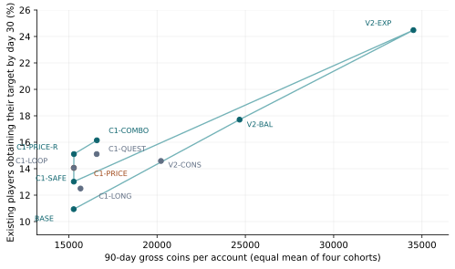
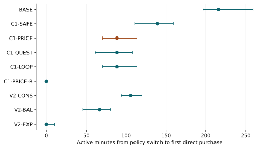
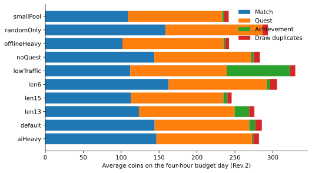
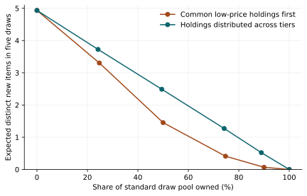

# YachtLab C1 경제 v2 최종 연구 보고서

## 결정 요약

**조건부 추천은 C1-PRICE다.** 현재 품목별 기준 가격에서 일반 55%, 고급 70%, 영웅 90%, 전설·신화 100%를 적용한다. 일반 주사위는 300→165코인, 고급은 1,000→700, 영웅은 3,000→2,700이다. 코인과 보석 모두 같은 비율을 쓰고 각각 5코인·1보석 단위로 내림한다. 경기·퀘스트·업적 지급, 강화, 상한, 뽑기, 등급은 그대로 둔다. 부스터 도입은 보류한다. [전체 후보 설정](v2/codex/candidates.json) · [품목별 가격·강화·확률](v2/codex/catalog-and-draw.json)

독립 평가에서 하루 60분을 가정한 기존 사용자의 첫 직접 구매는 정책 전환 후 중앙값 **215.6→88.4 플레이분**이었다. 뽑기까지 포함한 다음 상품은 **100.8→41.1분**이었고, 네 코호트의 90일 발행량 단순 평균은 **15,280→15,287코인**이었다. 기존 사용자가 30일 내 원하는 상품을 얻은 비율은 10.9%→14.1%였다. 대응 차이 +3.1%p의 95% 시드 블록 구간은 **−3.2~+9.5%p**다. 원하는 상품의 개선은 재확인이 필요하다. 같은 집단의 90일째 직전 30일간 구매가 없던 표본은 0.5%→2.1%로 늘었다. [독립 평가 원시 표본·집계](v2/codex/H1) · [평가 규약](v2/C1-EVALUATION-PROTOCOL.md)

가격 인하를 바로 승인하기보다 가까운 기존 사용자와 소규모 평가 후 결정할 것을 권한다. 고가 목표 위주 사용자와 진척이 느린 저활동 사용자를 포함한다. 전환 시 기존 소유권·강화·장착을 유지하고 소급 차액 지급은 우선 보류한다. 가격 승인, 등급 변경 승인, 운영 활성 버전 확인은 C5에서 별도로 진행한다. [C5 인수인계](v2/HANDOFF-C5-ECONOMY-V2.md)

## 기준선과 독립 코드 감사

| 기준 | 근거 | 연구에서의 취급 |
|---|---|---|
| Rev.1 | 마지막 성공 Worker 배포 소스 `54c1367` | 신규 11종 없음. 기존 보드 중 일부 Lv.1 전용 |
| Rev.2 | 감사 시작 시 `main` `d8a24a8` | 신규 11종 판매, 신규 11종 표준 뽑기 제외, 일부 보드 Lv.3 지원 |
| 운영 | C0 PR #112, 공개 상태 조회 | 활성 Worker 버전, 실제 계정별 매치·잔액·원장·플랜·바인딩·롤백 대상 미확인 |

11월 27일 14:38 KST 공개 조회에서 `/healthz`는 응답했고, `/usage`는 방 5/300, 서버 AI 방 2/100, 활성 방 0/50을 반환했다. 하루 일부 시점의 카운터다. 이 값으로 실제 사용자 수·모드 비율·대기분포·판매 revision은 추정할 수 없다. [C0 #112](https://github.com/oyueo-mm/YachtLab/pull/112) · [마지막 성공 배포 기록](https://github.com/oyueo-mm/YachtLab/actions/runs/45772443229) · [Rev.1 배포 소스](https://github.com/oyueo-mm/YachtLab/commit/54c1367) · [공개 집계](https://yachtlab-online.hoho96385210.workers.dev/usage)

| 검증 대상 | 확인 사항과 조치 |
|---|---|
| 경기 정산 | 서명된 서버 경기 결제 순서 1~10 전액, 11~30 3코인, 31부터 경기 코인 0. 친구 10·동일 상대 3 제한은 공유 지급 순번보다 먼저 적용. 상대 기권으로 내 기록 6칸 도달 시 완료분만 지급. 본인 기권은 0 |
| 퀘스트·업적 | 자정 KST, 월요일 KST 초기화. 정상 기록은 경기 코인 상한 후에도 퀘스트 진행. 경기 카운터 상한 40회와 접속·연승·업적 규칙을 따로 재현. 두 주 경계에서 중복 원장키 없음. 사용자 정산 순서의 재시도·멱등은 Worker의 저장 계층 계약 |
| AI 용량 | 계정 시작 30회는 KST 경계. 방 배정기 공용 100 AI 방/300 전체 방은 UTC 경계이며 동시 50방도 별도. 교정 모델은 시작 시각으로 계정 상한을 처리하고 UTC 마감 민감도를 둔다. 일부 실패한 시도도 계정 시작 한도를 소모할 수 있다 |
| 가입 | 기본 200코인·20보석, 정확한 가입 후 7×24시간 전까지 전액 구간 경기 +5. 신규 샘플 가입 시각을 세션 이전으로 고정. 재가입 대기 30일은 가입 일시금과 다른 분기 |
| 매치 이벤트 | 상수는 현재 비어 있다. 활성 가상 이벤트에 시작 포함·종료 제외, 전액 구간 +코인, 이벤트 목표 1회 지급을 검증했다. 완료 목표는 경기 코인 상한 이후에도 모드 제한을 통과한 경기에서 진행 가능 |
| 구매·강화·뽑기 | 표시 가격과 정산 단위를 재검산. Rev.1 보드의 1단계 전용을 복원하고 Lv.1 전용 채팅의 강화비는 0. 구매·신규 뽑기에서 보유 수 업적을 지급하게 수정. Rev.1 232품목과 Rev.2 243품목의 ID·등급·두 통화 가격·최대 레벨·강화 단계값을 원본 코드와 각각 대조했다. 돈이 없어도 기본 품목은 이용 가능. 기존 보유와 업적 전용 외형은 귀속을 유지 |
| 시간과 소비 | 교정 모형은 세션 시작, 정산 직후, 종료에 소비를 시도. 거래의 KST 일일/주간 키는 실제 거래 시각으로 계산. 시작 시점에 이미 구매 가능한 경우 0 플레이분 기록. 분 단위 시간에는 대기 포함 |
| 보유 가치·보존 | 정책 현재 정가와 BASE 고정 정가를 별도 집계. 보석 전용은 연구용 고정 20코인 표기 환산을 사용하며 실제 교환율은 없다. 잔액 변화는 코인/보석별 발행과 소비 합계에 일치 |

연구 코드는 [엔진](../../src/economy/v2/engine.ts), [시뮬레이터](../../src/economy/v2/sim.ts), [독립 경계 테스트](../../tests/economy-v2.test.ts)에서 볼 수 있다. 기준 정산은 [현행 보상](../../src/economy/live/rewards.ts), [Worker 원장](../../worker/src/economy.ts), [방 배정](../../worker/src/index.ts)을 대조했다.

### Claude 결과와 재실행

원본은 1,108개 Job, 208,140명, E1 원시 76,800행이다. 원본 코드가 경제일과 상대 시뮬레이션 일자를 비교해 `reducedDayShare`, `cappedDayShare`, `everCapped`가 0에 고정됐다. 원본 표와 그림은 감사의 역사적 입력이다. 재현에서는 기존 소비와 경기 가정을 유지한 채 수정한 세 지표를 집계하며 지급·소비·보유·소요시간과 원시 행을 별도로 비교한다. [Claude 원본 보고서](https://github.com/oyueo-mm/YachtLab/blob/e814568/docs/economy/ECONOMY-V2-RESEARCH.md) · [기존 원시 E1](v2/raw/E1-users.csv.gz) · [Claude 실행 로그](v2/logs/run-full-2026-11-27.log) · [대조 스크립트](../../scripts/economy/v2/compare-replay.py)

독립 교정에서는 보유 업적 누락, 세션과 거래의 초기화, 자정 이후 AI 시작, 자동 부스터 첫 경기, 첫 구매 쿠폰 소진, 무료 뽑기 상한, Rev.1 강화, 취향 전환을 보완했다. 초기 개발 점검에서 워밍업 직후 선호 생성 방식이 바뀌면 BASE에서도 즉시 구매가 과대 집계되는 문제를 발견했다. 워밍업과 평가에 같은 선호를 사용하여 E8을 다시 돌리고 H1을 실행했다. 과거 시드 20261127/20261128과 H1의 시드 4개는 분리했다. 동일한 실험 정의로 실행된 기존 표와 교정 결과는 직접 같은 모형으로 해석할 수 없다. [평가 규약 및 수정 기록](v2/C1-EVALUATION-PROTOCOL.md) · [실행 파일](../../scripts/economy/v2/run.ts)

## 후보 비교와 정책 선택

| 정책 | 핵심 설정 | 기존 첫 직접 구매, 중앙값 분 | 기존 원하는 상품 30일 | 네 코호트 평균 90일 코인 | 신규 90일 보유 |
|---|---|---:|---:|---:|---:|
| BASE | 현행 설정 | 215.6 | 10.9% | 15,280 | 63.2 |
| C1-SAFE | 보수 개선, 일반 70%, 고급 80% | 139.5 | 13.0% | 15,286 | 68.1 |
| **C1-PRICE** | **가격 55/70/90/100/100%** | **88.4** | **14.1%** | **15,287** | **71.3** |
| C1-QUEST | C1-PRICE + 일퀘 1.25배 | 88.4 | 15.1% | 16,581 | 73.9 |
| C1-LOOP | C1-PRICE + 일반·고급 강화 1→2 각각 65/75%, 2→3 80/90% | 88.4 | 14.1% | 15,288 | 71.5 |
| C1-LONG | 일반·고급 65/80%, 주간 3/5/8연승 15/30/50, 컬렉션 150코인/보석 5, 업적 1.1배, 신규 25% 할인·1회 뽑기 | 139.1 | 12.5% | 15,666 | 70.7 |
| C1-PRICE-R | C1-PRICE + 확정 주사위·이모티콘 등급 | 0 | 15.1% | 15,292 | 72.1 |
| C1-COMBO | C1-PRICE-R + C1-LOOP 강화 + 일퀘 1.25배 | 0 | 16.1% | 16,591 | 74.8 |
| V2-CONS | 경기 1.5배, 일퀘 1.5배, 일반/고급 70/80%, 신규 할인·무료 3회 | 106.1 | 14.6% | 20,221 | 78.6 |
| V2-BAL | 균형안, 경기 2배·일퀘 1.5배·주간 1.25배, 가격/강화 인하, 중복 50, 시작·연승·컬렉션 | 66.9 | 17.7% | 24,672 | 86.8 |
| V2-EXP | 확대안, 경기 2.5배·일일 범위 15/40, 다중 공급, 중복 75·하루 10회 | 0 | 24.5% | 34,516 | 103.3 |

후보/코호트당 192명, 네 시드 × 48명. 전체 11개 정책, 176개 Job, 8,448명. BASE와 C1-PRICE의 기존 직접 구매 95% 구간은 각각 196.6~259.3분, 70.5~113.4분이다. 기존 30일 구매 여부는 모든 정책에서 포화됐다. 원하는 상품 개선은 C1-PRICE의 시드별 +0.0/+4.2/+0.0/+8.3%p로 작고 불확실하다. V2-EXP는 +13.5%p, 95% 시드 블록 구간 +2.5~+24.5%p지만 평균 발행량이 BASE의 2.26배이고 신규 90일 보유가 40.1개 더 많다. [H1 전 지표와 시드별 결과](v2/codex/H1/summary.json)

- E8 단독 가격 탐색은 일반 50/60/70/80%, 고급 55/70/85%의 12점과 선택적 영웅 할인·퀘스트·1.1배 경기 조합을 포함한다. C1-QUEST-MIX는 정책 후보 설정을 유지하고 탐색표에서 해석한다. 확정 등급은 아이템 가격·희소성과 기존 강화에 직접 영향을 주므로 한 번에 적용할 비용이 크다. [E8 개발 결과](v2/codex/E8/E8.json) · [설정](v2/codex/candidates.json)
- 채택 후보는 첫 획득을 빠르게 하고 지급원과 운영 복잡도를 줄이는 쪽으로 선택했다. C1-SAFE는 더 작은 변경의 대안이다. C1-QUEST는 실제 사용자가 일일 퀘스트에서 잘 이탈하고 그 개선이 목표 상품 도달을 높이는 경우에 재평가한다. C1-LOOP는 강화 관심 표본의 Lv.2/Lv.3 도달 및 그 다음 구매가 개선되면 채택할 수 있다.
- 주요 Pareto 축은 신규 7일 첫 획득, 기존 30일 직접 구매와 목표 도달, 저활동 30일 구매, 90일 발행이다. BASE, C1-SAFE, C1-PRICE, C1-PRICE-R, C1-COMBO, V2-BAL, V2-EXP가 비지배 집합이다. 고정 가중치 합계를 쓰지 않았다. Lv.3·구매 공백을 추가하면 V2-CONS도 포함된다. 저활동 30일 구매율과 발행량만 보면 BASE와 C1-SAFE가 남는다. 이 축은 99.5~100%에서 포화되므로 활성 분 중앙값과 7일 도달을 함께 본다. [Pareto 설정 및 결과](v2/codex/H1/summary.json)

## 신규·기존·저활동·고활동

| 코호트 | 다음 획득 중앙값 BASE→C1-PRICE, 분 | 직접 구매, 분 | 7일 첫 획득 | 목표 30일 | 90일 평균 보유 | 90일 코인 잔액 |
|---|---:|---:|---:|---:|---:|---:|
| 신규 30분 | 0→0 | 0→0 | 100→100% | 26.0→31.2% | 63.2→71.3 | 307→312 |
| 기존 60분, 60일 | 100.8→41.1 | 215.6→88.4 | 100→100% | 10.9→14.1% | 94.0→95.8 | 508→597 |
| 저활동 주말 15분, 30일 | 23.9→0 | 25.0→0 | 76.0→90.6% | 6.8→11.5% | 23.0→29.9 | 111→125 |
| 고활동 240분, 90일 | 263.9→105.1 | 523.5→169.5 | 96.4→98.4% | 7.8→8.9% | 96.9→97.5 | 888→853 |

첫 획득에는 직접 구매와 뽑기를 포함한다. 기존 사용자의 첫 직접 구매는 정책 전환 뒤 첫 거래다. 이어지는 두 번째 거래, 구매 사이 간격, 30일 이상 공백, 등급별 도달/미도달, 첫 Lv.2/Lv.3, 컬렉션·시너지, 코인·보석 구매 가능 품목 수는 셀의 날짜별 지표로 제공한다. 신규는 시작 보석과 저가 상품이 있고 구매를 자동 시도하는 가정이라 0분이 빈번하다. 시뮬레이션의 구매 동기, 보유 현황 및 기간에 대한 민감도를 고려한다. [H1 상세 지표](v2/codex/H1/H1.json)

C1-PRICE에서 기존 60분 집단의 90일 BASE 고정 보유가는 99,280→102,091 연구용 코인 등가, 신규는 46,546→53,698이다. 기존 집단의 순발행은 234→324, 신규는 307→312코인이다. 고활동 잔액은 오히려 감소했다. 발행, 소각, 구매력, 보유 가치, 평균 보유량을 함께 해석한다. 사용자 간 거래·환금 시장이 없는 경제다.

## 4시간 피드백과 매칭 민감도

4시간 예산 안에서 모드·대기·경기 길이를 바꿨다. 실제 구현상 정상 경기 완료에 시간이 더 걸리거나 퀘스트를 위해 최대 두 경기를 더 할 수 있어 추정 평균은 약 244~251분이다. 기존 사용자는 각 상황에서 60일 워밍업했다. 아래 숫자는 E9 Rev.2의 시뮬레이션 평균이다.

| 상황 | 실제 플레이+대기 분 | 대기 분 | 보상 경기 | 경기 | 일·주 퀘스트 | 업적 | 중복 보상 | 총 코인 |
|---|---:|---:|---:|---:|---:|---:|---:|---:|
| 기본 혼합 | 245.3 | 10.0 | 24.1 | 144.1 | 124.8 | 7.7 | 8.8 | 285.4 |
| 저트래픽, 2분 후 오프라인 | 244.8 | 25.6 | 15.5 | 112.0 | 127.1 | 83.3 | 7.1 | 329.5 |
| 6분대 경기 | 244.0 | 15.2 | 30.1 | 162.6 | 129.6 | 4.2 | 9.1 | 305.5 |
| 13분대 경기 | 247.9 | 7.5 | 17.3 | 123.4 | 126.0 | 19.3 | 6.9 | 275.5 |
| 15분 경기 | 251.3 | 6.0 | 13.7 | 113.0 | 121.7 | 5.3 | 5.6 | 245.6 |
| 오프라인·1인 위주 | 244.3 | 5.3 | 10.9 | 101.7 | 133.1 | 2.1 | 5.3 | 242.1 |
| 동일 상대 풀이 3명 | 245.4 | 18.2 | 10.5 | 109.3 | 124.0 | 2.5 | 5.9 | 241.7 |

저트래픽에서 경기 수입은 32.1코인 줄고 대기는 15.6분 길었다. 업적 지급이 75.6코인 많아 합산은 44.1코인 높았다. 시나리오별 워밍업 기간에 달성한 업적과 목요일에 새로 달성한 업적의 분포 차이가 이 하루 관찰을 좌우한다. 반복 지급 가능한 경기만 보면 저트래픽이 불리했다. 일일 퀘스트는 79.3→79.2코인, 주간은 45.5→47.9코인이었다. 저트래픽 업적 수입의 대부분은 누적 500승 42.0코인(1인당 평균)과 누적 200요트 40.3코인이었다. 워밍업 중 이미 달성한 업적은 같은 날 다시 지급되지 않는다. 자동 정산 내역이 없는 ‘4시간 플레이’ 제보는 운영 모드·당시 계정 상태 확인이 필요하다. [E9 두 카탈로그와 신규·기존 결과](v2/codex/E9/E9.json) · [퀘스트 기간·업적별 산출](v2/codex/sources-and-booster-traffic.json)

## 부스터

C1-PRICE에서 시간제 ×1.5/2, 경기 3/5회, 추가 60코인 상한, 자동 첫 3회, 금~일 이벤트, 할인권, 무료 뽑기권, 미도입을 시험했다. 시간제 사용률은 발급 분 중 보너스가 지급된 경기의 창 내 시간으로 계산한다. 일반 코호트는 60분·기존, 저트래픽은 30분·신규여서 집단 차이에는 세션 길이와 계정 연차도 포함된다. [17개 대안 및 코호트별 소각·발행](v2/codex/E11/E11.json)

| 대안 | 30일 일반 추가 경기 코인 | 저트래픽 추가 경기 코인 | 주요 비용 |
|---|---:|---:|---|
| 미도입 | 0 | 0 | 기본 경제만으로 사용자 반응 확인 |
| 시간 10분 ×2 | 433 | 198 | 유효 시간 사용 약 80% vs 37%. 대기·일찍 끝난 경기 영향 |
| 시간 15분 ×2 | 577 | 254 | 유효 시간 사용 약 81% vs 39% |
| 시간 30분 ×2 | 1,026 | 470 | 유효 시간 사용 약 82% vs 40% |
| 시간 60분 ×2 | 1,935 | 663 | 유효 시간 사용 약 82% vs 32%, 장시간 접속 유도 가능성 |
| 첫 3회 또는 자동 첫 3회 ×2 | 914 | 607 | 같은 지급량. 자동 방식 사용 손실이 작고 중첩 규칙 필요 |
| 추가 코인 60 한도 | 1,749 | 663 | 잔여량 안내와 일일 멱등 정산 |
| 금~일 서버 이벤트 | 618 | 180 | 일정 편향, 이벤트 경계와 정책 버전 |
| 할인권만 / 무료 뽑기권만 | 0 / 0 | 0 / 0 | 할인은 소비를 줄이고 뽑기권은 중복 지급과 콘텐츠 소진에 영향 |

일반 집단의 무부스터와 시간제 및 경기제의 첫 직접 구매 중앙값은 약 18.5분이어서 30일 추가 발행의 즉시 구매 개선이 확인되지 않았다. 할인권은 이미 예산이 있는 기존 사용자에게 즉시 효과가 있었다. 저트래픽 코호트의 30일 목표 도달은 미도입 26.7%, 무료 뽑기권 30.0%였다. 코호트당 60명 개발 결과라 작은 차이에 상당한 불확실성이 있다. 신규 30분 사용자로 세션·가입 조건을 맞춘 추가 시험에서 시간제 10분 ×2 사용률은 일반 79.6%, 저트래픽 39.1%였고, 추가 발행은 431→199코인이었다. 경기제 3회 ×2의 1회 이상 혜택 사용 세션 비율은 각각 100%, 95.9%였다. 시간 압박과 재미는 실제 사용자 평가 대상이다. [조건 대응 부스터 민감도](v2/codex/sources-and-booster-traffic.json) 부스터 채택은 가격 기본안 검증 뒤 별도 판단한다.

## 뽑기와 카탈로그

| 카탈로그 | 비시즌 판매 수 | 구매 총 코인 | 전체 강화 총 코인 | 표준 뽑기 평균 표시가 |
|---|---:|---:|---:|---:|
| Rev.1 | 201 | 661,520 | 870,120 | 1,237.5 |
| Rev.2 | 212 | 732,620 | 983,790 | 1,237.5 |
| 확정 주사위·이모티콘 | 212 | 750,320 | 1,009,835 | 1,239.6 |
| 확정 + 제안 보드 | 212 | 790,820 | 1,069,235 | 1,239.6 |
| 제안 채팅만 | 214 | 795,815 | 983,790 | 1,164.7 |
| 제안 채팅 + 보드 및 확정 등급 | 214 | 854,015 | 1,069,235 | 1,168.2 |
| C1-PRICE | 212 | 703,195 | 983,790 | 1,070.1 |

신규 11종 표준 뽑기 제외가 두 Rev.에서 동일한 뽑기 값의 원인이다. 확정 등급 변경 뒤 일반/고급/영웅/전설/신화의 표준 풀은 57/48/46/27/12에서 59/47/44/29/11로 바뀐다. 품목별 추첨 확률은 해당 등급 확률을 풀 품목 수로 나눈 값이다. 제안 채팅은 38개를 실제 판매·뽑기에 포함해 일반 9, 고급 8, 영웅 9, 전설 7, 신화 5로 배분한다. 일치 문구의 기존 ID와 레벨을 유지하고 새 문구는 연구용 별도 ID를 사용했다. 기존 판매 채팅 중 제안에서 빠진 품목은 기존 보유자 권리를 유지하며 신규 판매·뽑기에서 제외하는 시나리오를 택했다. 새 기본 문구 6개와 기존 `chat.great` 무료 자격은 증분 권리 모델이다. 시즌 아이템은 이 비시즌 표준 비교에서 제외했다. [등급별·품목별 가격과 확률](v2/codex/catalog-and-draw.json)

현행 뽑기는 250코인, 중복 25코인, KST 하루 최대 5회다. 뽑기 표시 정가 기대값 1,237.5코인은 환금 가능한 가치와 무관하다. 190종 표준 풀의 절반을 보유하면 저가부터 모은 경우의 중복 확률은 70.7%, 등급별 균형 보유는 49.6%다. 같은 사람이 5회 쓸 때 기대 신규 품목은 각각 1.45개와 2.49개다. 90% 저가 편중 보유에서는 5회 기대 신규 품목 0.07개, 기대 순비용 1,127코인이다. 신규가 보유 없이 5회 뽑으면 기대 신규 품목이 4.93개다. 초기에 뽑기 효율이 높아도 특정 품목은 직접 구매가 확실하다. Rev.2 특정 일반·신화 품목의 1회 확률은 각각 0.704%, 0.00643%다. 미보유 품목을 `n`회 내 얻을 확률은 `1-(1-p)^n`으로 계산한다. 10회 상한은 동일 10회를 하루 안에 가능하게 만들며 개별 확률은 일정하다. [보유별 1·5·10·30·150회 정산](v2/codex/catalog-and-draw.json)

## 장기 소진·강화·수집

| 정책, 신규 60분 | 180일 평균 보유 | Lv.3 평균 | 컬렉션 평균 | 시너지 평균 | 전설 / 신화 평균 | 30일 공백 경험 |
|---|---:|---:|---:|---:|---:|---:|
| BASE | 102.7 | 1.0 | 0.1 | 1.1 | 4.1 / 0.1 | 24.1% |
| C1-PRICE | 108.6 | 1.0 | 0.1 | 1.1 | 4.4 / 0.1 | 61.1% |
| C1-LOOP | 108.7 | 1.0 | 0.1 | 1.1 | 4.4 / 0.1 | 59.3% |
| C1-LONG | 108.5 | 1.0 | 0.1 | 1.1 | 4.4 / 0.1 | 61.1% |
| V2-EXP | 149.5 | 1.0 | 1.0 | 3.0 | 9.9 / 0.3 | 31.5% |

각 셀 54명이며 구매 공백은 180일 내 최대 직접 구매 공백이다. 뽑기로 계속 품목을 얻어도 직접 구매 공백은 늘 수 있다. 기본 소비자는 즐겨찾기 1종을 강화하므로 Lv.3에서 포화된다. 강화 중심과 수집 중심의 별도 민감도를 보아야 한다. 기존 수집형의 180일 평균 보유는 BASE 123.9, C1-PRICE 128.4, V2-EXP 155.5다. 가격 중심안은 장기 희소성을 대체로 유지하면서 초기 접근을 높인다. 빠르게 저가품을 소진한 사용자의 구매 공백 증가가 가장 중요한 반대 근거다. C5 검증에 목표 선택과 공백을 반드시 포함한다. [E13 1·7·30·90·180일 결과](v2/codex/E13/E13.json)

## 악용 억제와 공정성

| 30일 격리 성향 | BASE | C1-PRICE | C1-QUEST | V2-EXP |
|---|---:|---:|---:|---:|
| 서버 AI 24시간 | 10,302 | 10,302 | 10,932 | 22,010 |
| 빠른 대전 24시간 | 11,654 | 11,654 | 12,284 | 28,136 |
| 친구 대전 반복 | 8,897 | 8,897 | 9,527 | 17,546 |
| 같은 상대의 기권 완료 인정 | 5,587 | 5,587 | 6,036 | 10,142 |
| 본인 기권만 | 0 | 0 | 0 | 0 |

숫자는 시뮬레이션의 30일 총 코인 평균이다. 본인 기권은 지급 경로가 없고, 상대 기권은 내 기록 6칸 이상에서 완료분을 지급한다. 동일 상대 3회 및 친구 10회 이후에도 정상으로 집계되는 경기의 퀘스트와 일부 업적은 진행된다. 이러한 구조는 기존 경제에서 이미 존재한다. C1-PRICE는 가상 자동화 사용자에게 같은 양을 발행하면서 구매력을 높인다. 빠른 대전 자동 플레이가 30일 동안 항상 가능한 가정은 상대·매칭·용량 측면에서 강한 상한 시나리오다. [E12 결과](v2/codex/E12/E12.json)

AI 전용 계정의 Rev.2 기준 최대 일반 경기 코인은 10×9 + 20×3 = 150/일이다. V2-EXP에서도 계정의 30회 시작 제약으로 16~40번째 경기 보상 구간 전체에 도달하지 못한다. 공용 100방/UTC일의 경기 코인 상한은 BASE 900코인과 V2-EXP 2,300코인이다. 신규 추가, 일·주 퀘스트, 업적은 이 수치에서 따로 계산한다. 별도 격리 모형은 7 KST일의 요청을 시간순으로 합치고 UTC 100 AI 방·300 전체 방·50 동시방을 공유하도록 했다. 40명·비AI 방 50건/일 요청에서 BASE AI 경기 코인 상한 합계가 계정 제한만 적용할 때 15,864에서 공유 한도 적용 시 6,840으로 감소했다. UTC 날짜가 넘어가는 순서와 기존 수요 분포에 따라 이용 기회가 달라진다. 동시 접속 실측 자료는 없다. [공유 용량 이벤트 결과](v2/codex/shared-capacity.json) 재가입 일시금 제한은 신규 인증 계정의 구매력·부정 방지 가치와 함께 평가한다. 가격 할인은 신규 계정 임의 생성을 차단하는 장치가 아니다. [계정·공용 산식](v2/codex/capacity.json) · [E12 신규/재가입 7일 자료](v2/codex/E12/E12.json)

부스터 연구 엔진은 지급 가능한 1개의 부스터와 키를 사용했다. 운영 적용 전에는 시작 시점 정산 증거, 하루 상한, 쿠폰 한도, 병렬 재시도의 원자적 멱등 검증이 필요하다. 시간제 장시간 자동화 및 최초 계정 지원의 인센티브는 기본 정책과 분리해 판단한다.

## 기존 구매자 보호

300개 가상 원장, 직접 구매·강화·뽑기 19,767건으로 비용을 계산했다. C1-PRICE에서 무지급 0, 구매 차액의 25%는 171,251코인과 15,065보석, 한 번 이상 구매한 계정당 100코인은 30,000코인, 구매·강화 차액의 50%와 계정별 500코인 한도는 133,101코인과 30,290보석이었다. 뽑기 지출은 가격 차액 보상에서 제외했다. 소유자 강화 가격 보호는 재분류안에서 추가 검토한다. C1-PRICE-R의 가상 300계정 중 280개가 보호 대상 강화 상승 품목을 한 번 이상 취득했다. 이는 시뮬레이션 활동·보유 구성에 따른 값이다. 승인 전 운영 원장에서 실제 자격과 소요량을 추정한다. [가상 원장 및 대안별 산식](v2/codex/synthetic-ledger.json.gz) · [운영·이전·되돌리기](v2/HANDOFF-C5-ECONOMY-V2.md)

## 실제 사용자 검증

- 운영 버전·판매 가능 revision, 접근 가능한 익명 집계, 모드/기간별 지급·퀘스트·상한·실패 원인을 먼저 확인한다. 4시간 실제 경험은 구체적 모드, 순 플레이·대기, 지급 순번, 잔액, 구입 희망 품목을 당사자 동의하에 확인한다.
- 격리 계정에서 신규·기존·저활동 6~12명 규모의 짧은 과제와 인터뷰부터 진행한다. 첫 구매·원하는 품목을 안내 없이 찾는지, 뽑기와 직접 구매를 구분하는지, 리듬·대기·강화에 대한 만족도와 부스터 시간 압박을 살핀다.
- 이용자 수가 작으면 기간별 전후 비교, 같은 참가자의 순서 균형 테스트, 운영 승인 후 작은 단계 적용으로 검증한다. 경기 모드·시즌·주말·신규 유입 차이를 기록하고 신뢰구간과 미도달을 보고한다.
- 필요한 익명 집계는 일/주, 모드·플레이 길이 구간, 보상 출처, 아이템 유형/등급, 요청 성공·오류, 지출·잔액 범위, 판매 revision이다. 닉네임, 방 코드, 원시 채팅, IP, 원시 기보를 수집하지 않는다. 소규모 셀 억제, 단기 시점별 임의 키와 접근 제한, 원시 연구 이벤트 보관 종료 시 삭제 기준을 승인 전에 정한다.
