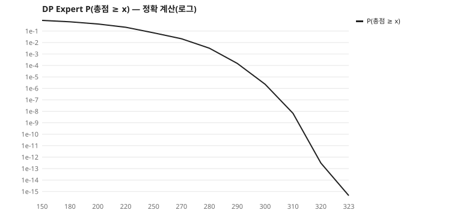
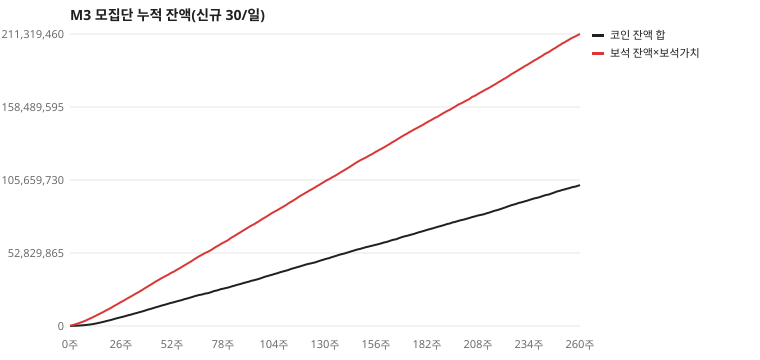

# 경제 연구 결과 (자동 생성)

> `scripts/economy/report.ts`가 `docs/economy/results/*.json`에서 생성. 손으로 고치지 말고 실험을 다시 실행하세요. 해석·추천은 [ECONOMY-RESEARCH.md](./ECONOMY-RESEARCH.md).

- 실행: 시드 20261124, 사용자 유형당 200명, 기간 7일·30일·90일·180일·1년·3년·5년, 실행 시간 784초.
- 코인 단위: 모든 모델의 코인 지급을 정규화해 **일반 유저(로그인·무과금)의 1년 중앙 획득량 = 100코인/일**. 보석은 정규화하지 않음. 보석 1개 ≈ 22.9코인(일반 유저 획득 시간 동등).
- 모든 사용자 행동 수치는 **가정**(실제 사용자 데이터 없음).

## 1. 실제 게임 데이터(숙련도 단계별 동형 대전)

엔진 `src/engine.ts` + DP Expert 행동가치 소프트맥스 정책(온도 τ). 시드 71000000~(경제 연구 개발용, 홀드아웃 아님). 단계당 20,000경기(=40,000 플레이어 기록), 교차 대전 쌍당 3,000경기(선후공 교대).

| 단계 | τ | 평균(표준편차) | p10/p50/p90 | 상단 보너스 | 요트 | 라지 | 200+ | 250+ | 270+ | 0점 없음 | 역전승(9R −30) |
|---|---|---|---|---|---|---|---|---|---|---|---|
| 입문 | 2.5 | 127.1 (33) | 87/123/172 | 19.1% | 8.2% | 63.6% | 2.2% | 0.05% | 0.00% | 0.20% | 1.08% |
| 초급 | 1.6 | 149.8 (35.5) | 106/146/195 | 34.4% | 13.4% | 70.7% | 8.0% | 0.41% | 0.05% | 1.07% | 1.81% |
| 중급 | 1 | 168.4 (36.7) | 121/167/215 | 48.9% | 19.2% | 74.6% | 18.8% | 1.62% | 0.27% | 2.59% | 2.16% |
| 숙련 | 0.5 | 184.9 (37.3) | 137/188/234 | 62.7% | 25.5% | 77.8% | 33.9% | 4.55% | 1.16% | 5.71% | 2.59% |
| 전문가(DP Expert) | 0 | 191.5 (37.8) | 142/193/242 | 68.8% | 28.2% | 78.1% | 41.4% | 6.91% | 2.09% | 7.70% | 2.65% |

교차 승리 점수율(행 기준, 무승부 0.5):

|  | 입문 | 초급 | 중급 | 숙련 | 전문가(DP Expert) |
|---|---|---|---|---|---|
| 입문 | 0.5 | 0.303 | 0.195 | 0.121 | 0.109 |
| 초급 | 0.697 | 0.5 | 0.355 | 0.227 | 0.217 |
| 중급 | 0.805 | 0.646 | 0.5 | 0.369 | 0.328 |
| 숙련 | 0.879 | 0.773 | 0.631 | 0.5 | 0.44 |
| 전문가(DP Expert) | 0.891 | 0.784 | 0.673 | 0.561 | 0.5 |

## 2. 희귀 사건: 정확 계산·중요도 표집

- DP Expert 정확 점수 분포: 질량 1, 평균 191.760879752 vs DP 테이블 191.760879752 (오차 1.4e-13), 계산 31초.

| 총점 ≥ | 150 | 180 | 200 | 220 | 250 | 270 | 280 | 290 | 300 | 310 | 320 | 323 |
|---|---|---|---|---|---|---|---|---|---|---|---|---|
| P (정확) | 85.57% | 64.54% | 41.53% | 21.56% | 7.03% | 2.14% | 0.32% | 1.51e-4 | 2.29e-6 | 6.65e-9 | 3.05e-13 | 4.41e-16 |
| 기대 경기 수 | 1 | 2 | 2 | 5 | 14 | 47 | 312 | 6,605 | 436,486 | 150,332,819 | 3,283,402,092,770 | 2,268,926,753,866,739 |

- 동급 DP Expert 1:1: 무승부 0.780%, 100점 이상 차 승리 3.17%, 150점 이상 0.188%.
- 첫 굴림 요트: 굴림당 7.72e-4, 경기당 ≥1 0.92%, ≥2 3.91e-5, ≥3 1.01e-7.
- 한 턴 최적 요트 4.60%, 6 요트 1.33%, 라지 26.11%.
- 목표 최적(그 목표만 노리는 플레이어) 경기 확률: 323점 완벽 3.21e-14, 상단 105점 4.56e-7, 0점 없는 경기 30.12%, 특수 족보 5종 모두 31.28%.

중요도 표집(교차 엔트로피로 면 분포 조정) 검증 — 몬테카를로 20,000경기와 정확값 비교:

| 임계값 | 정확 | MC | IS 추정(±SE) | 판정 |
|---|---|---|---|---|
| 250 | 7.03% | 6.92% | 7.20% ± 0.18% | 일치 |
| 270 | 2.14% | 2.08% | 1.99% ± 9.39e-4 | 일치 |
| 290 | 1.51e-4 | 2.50e-4 | 2.32e-4 ± 9.23e-5 | 일치 |

> 면 분포만 기울이는 IS(6개 매개변수)는 고득점이 특정 족보 조합(요트·스트레이트)에 의존해 효율이 낮다: 290점에서 상대오차 40%(첫 시험인 표본 1,000~2,000개에서는 290점 이상 적중 0). 그래서 극희귀 점수 업적(300·310·323점)은 **정확 분포**로 판정하고 IS는 교차 검증용으로만 쓴다.

## 3. 퀘스트 후보 달성 확률(일반 유저 경기 수, 중급 기준)

| 퀘스트 | 주기 | 난이도 | 경기당 p(중급) | 기대 경기 수(입문/중급/전문가) | 기간 내 달성(입문/중급/전문가) |
|---|---|---|---|---|---|
| 경기 3회 완료 | daily | 쉬움 | 100.0% | 3 / 3 / 3 | 77% / 77% / 77% |
| 풀 하우스 1회 기록 | daily | 쉬움 | 75.2% | 2 / 1.3 / 1.2 | 89% / 96% / 98% |
| 스몰 스트레이트 1회 기록 | daily | 쉬움 | 95.5% | 1.2 / 1 / 1 | 98% / 99% / 99% |
| 1승 | daily | 보통 | 50.0% | 2 / 2 / 2 | 89% / 89% / 89% |
| 상단 보너스 1회 달성 | daily | 보통 | 48.9% | 5.2 / 2 / 1.5 | 62% / 88% / 95% |
| 라지 스트레이트 2회 기록 | daily | 보통 | 74.7% | 3.1 / 2.7 / 2.6 | 76% / 80% / 81% |
| 180점 이상 1회 | daily | 보통 | 40.3% | 12.9 / 2.5 / 1.6 | 35% / 84% / 93% |
| 2승 | daily | 어려움 | 50.0% | 4 / 4 / 4 | 67% / 67% / 67% |
| 200점 이상 1회 | daily | 어려움 | 18.8% | 46.1 / 5.3 / 2.4 | 12% / 62% / 84% |
| 요트 1회 기록 | daily | 어려움 | 19.3% | 12.2 / 5.2 / 3.5 | 37% / 62% / 74% |
| 포커 2회 기록 | daily | 어려움 | 37.0% | 9.3 / 5.4 / 3.8 | 35% / 56% / 69% |
| 경기 15회 완료 | weekly | 쉬움 | 100.0% | 15 / 15 / 15 | 66% / 66% / 66% |
| 풀 하우스 8회 | weekly | 쉬움 | 75.2% | 15.6 / 10.6 / 9.5 | 69% / 80% / 83% |
| 7승 | weekly | 보통 | 50.0% | 14 / 14 / 14 | 72% / 72% / 72% |
| 상단 보너스 5회 | weekly | 보통 | 48.9% | 26.2 / 10.2 / 7.3 | 48% / 81% / 88% |
| 요트 2회 | weekly | 보통 | 19.3% | 24.4 / 10.4 / 7.1 | 55% / 81% / 89% |
| 220점 이상 2회 | weekly | 어려움 | 7.9% | 299.6 / 25.4 / 9.4 | 2% / 53% / 84% |
| 요트 4회 | weekly | 어려움 | 19.3% | 48.8 / 20.8 / 14.2 | 23% / 58% / 72% |
| 12승 | weekly | 어려움 | 50.0% | 24 / 24 / 24 | 50% / 50% / 50% |
| 경기 60회 완료 | monthly | 보통 | 100.0% | 60 / 60 / 60 | 66% / 66% / 66% |
| 요트 8회 | monthly | 어려움 | 19.3% | 97.7 / 41.6 / 28.4 | 53% / 81% / 88% |

## 4. 업적 후보(기대 경기 수·난이도·보상)

보상 보석 = 1.5·√(중급 기대 경기 수), 상한 100(상징 등급은 업적 전용 아이템 추가). 1년 달성률은 M3 시뮬레이션.

| 업적 | 분류 | 경기당 p(중급) | 기대 경기 수(입문/중급/전문가) | 난이도 | 보석 | 1년 달성 라이트/일반/헤비/극단 |
|---|---|---|---|---|---|---|
| 경기 10회 완료 | cumulative | — | 10 / 10 / 10 | 쉬움 | 5 | 100% / 100% / 100% / 100% |
| 경기 100회 완료 | cumulative | — | 100 / 100 / 100 | 보통 | 15 | 100% / 100% / 100% / 100% |
| 경기 500회 완료 | cumulative | — | 500 / 500 / 500 | 어려움 | 30 | 0% / 100% / 100% / 100% |
| 경기 1000회 완료 | cumulative | — | 1,000 / 1,000 / 1,000 | 어려움 | 50 | 0% / 100% / 100% / 100% |
| 경기 5000회 완료 | cumulative | — | 5,000 / 5,000 / 5,000 | 매우 어려움 | 100 | 0% / 0% / 0% / 100% |
| 경기 10000회 완료 | cumulative | — | 10,000 / 10,000 / 10,000 | 매우 어려움 | 100 | 0% / 0% / 0% / 100% |
| 10승 | cumulative | — | 20 / 20 / 20 | 보통 | 5 | 100% / 100% / 100% / 100% |
| 100승 | cumulative | — | 200 / 200 / 200 | 어려움 | 20 | 100% / 100% / 100% / 100% |
| 500승 | cumulative | — | 1,000 / 1,000 / 1,000 | 어려움 | 50 | 0% / 100% / 100% / 100% |
| 2000승 | cumulative | — | 4,000 / 4,000 / 4,000 | 매우 어려움 | 90 | 0% / 0% / 100% / 100% |
| 요트 1회 | cumulative | 19.25% | 12 / 5 / 4 | 쉬움 | 5 | 100% / 100% / 100% / 100% |
| 요트 10회 | cumulative | — | 122 / 52 / 35 | 보통 | 10 | 100% / 100% / 100% / 100% |
| 요트 50회 | cumulative | — | 610 / 260 / 177 | 어려움 | 20 | 59% / 100% / 100% / 100% |
| 요트 200회 | cumulative | — | 2,441 / 1,039 / 709 | 매우 어려움 | 50 | 0% / 95% / 100% / 100% |
| 요트 1000회 | cumulative | — | 12,210 / 5,195 / 3,545 | 매우 어려움 | 100 | 0% / 0% / 59% / 100% |
| 상단 보너스 10회 | cumulative | — | 52 / 20 / 15 | 보통 | 5 | 100% / 100% / 100% / 100% |
| 상단 보너스 100회 | cumulative | — | 525 / 205 / 145 | 어려움 | 20 | 77% / 100% / 100% / 100% |
| 상단 보너스 500회 | cumulative | — | 2,624 / 1,023 / 727 | 매우 어려움 | 50 | 0% / 96% / 100% / 100% |
| 200점 이상 달성 | skill | 18.84% | 46 / 5 / 2 | 쉬움 | 5 | 100% / 100% / 100% / 100% |
| 200점 이상 25회 | skill | — | 1,153 / 133 / 60 | 어려움 | 15 | 72% / 100% / 100% / 100% |
| 250점 이상 달성 | skill | 1.62% | 2,105 / 62 / 14 | 보통 | 10 | 69% / 98% / 100% / 100% |
| 270점 이상 달성 | skill | 0.27% | ∞ / 370 / 48 | 어려움 | 30 | 33% / 84% / 100% / 100% |
| 0점 칸 없이 경기 완료 | skill | 2.59% | 500 / 39 / 13 | 보통 | 10 | 89% / 100% / 100% / 100% |
| 상단 모든 칸 3개 이상(정석 보너스) | skill | 3.00% | 140 / 33 / 14 | 보통 | 10 | 98% / 100% / 100% / 100% |
| 9라운드 후 30점 이상 뒤지다 역전승 | skill | 2.18% | 92 / 46 / 37 | 보통 | 10 | 100% / 100% / 100% / 100% |
| 온라인 무작위 대전 5연승 | skill | — | 62 / 62 / 62 | 보통 | 10 | 99% / 100% / 100% / 100% |
| 온라인 무작위 대전 10연승 | skill | — | 2,046 / 2,046 / 2,046 | 매우 어려움 | 70 | 9% / 42% / 78% / 99% |
| 첫 굴림 요트 | luck | 0.86% | 105 / 116 / 105 | 어려움 | 15 | 97% / 100% / 100% / 100% |
| 헥사 30점(6 다섯 개) | luck | 1.19% | 114 / 84 / 68 | 보통 | 15 | 99% / 100% / 100% / 100% |
| 마지막 라운드 요트 | luck | 8.25e-4 | 5,714 / 1,212 / 253 | 매우 어려움 | 50 | 19% / 59% / 96% / 100% |
| 첫 굴림 라지 스트레이트 10회 | luck | — | 27 / 27 / 27 | 보통 | 10 | 100% / 100% / 100% / 100% |
| 한 경기 첫 굴림 요트 2회 | special | 3.91e-5 | 25,580 / 25,580 / 25,580 | 극한 | 100+특수 | 3% / 3% / 19% / 25% |
| 300점 이상 | special | 0 | ∞ / ∞ / 436,500 | 극한 | 100+특수 | 0% / 0% / 0% / 1% |
| 한 경기 첫 굴림 요트 3회 | special | 1.01e-7 | 9.9e+6 / 9.9e+6 / 9.9e+6 | 상징(사실상 불가능) | 100+특수 | 0% / 0% / 0% / 0% |
| 310점 이상 | special | 0 | ∞ / ∞ / 1.5e+8 | 상징(사실상 불가능) | 100+특수 | 0% / 0% / 0% / 0% |
| 323점 완벽한 경기 | special | 0 | ∞ / ∞ / 2.3e+15 | 상징(사실상 불가능) | 100+특수 | 0% / 0% / 0% / 0% |
| 1~6 모든 눈으로 요트 | collection | — | 198 / 90 / 58 | 보통 | 15 | 98% / 100% / 100% / 100% |
| 서버 검증 경기를 한 날 30일 | collection | — | 180 / 180 / 180 | 어려움 | 20 | 100% / 100% / 100% / 100% |
| 서버 검증 경기를 한 날 100일 | collection | — | 600 / 600 / 600 | 어려움 | 40 | 99% / 100% / 100% / 100% |
| 서버 검증 경기를 한 날 365일 | collection | — | 2,190 / 2,190 / 2,190 | 매우 어려움 | 70 | 0% / 0% / 0% / 0% |
| 서버 검증 경기를 한 날 1000일 | collection | — | 6,000 / 6,000 / 6,000 | 매우 어려움 | 100 | 0% / 0% / 0% / 0% |
| 일일 퀘스트 30회 완료 | collection | — | 375 / 375 / 375 | 어려움 | 30 | 49% / 100% / 100% / 100% |
| 일일 퀘스트 180회 완료 | collection | — | 2,250 / 2,250 / 2,250 | 매우 어려움 | 70 | 0% / 62% / 100% / 100% |
| 일일 퀘스트 365회 완료 | collection | — | 4,563 / 4,563 / 4,563 | 매우 어려움 | 100 | 0% / 0% / 0% / 0% |

## 5. 모델 정규화

| 모델 | 설명 | 원래 일반 유저 코인/일 | 정규화 배수 | 일반 유저 보석/일 |
|---|---|---|---|---|
| M0 단순 신뢰(반례) | 모든 모드(로컬 AI 포함 클라이언트 기록)에 보상, 상한 없음. 어뷰징 위험을 측정하기 위한 반례 — 채택 후보 아님. | 252.5 | 0.396 | 4.48 |
| M1 경기 중심 | 경기 보상이 주 수급원(완료+승리), 퀘스트는 작게, 상한 없음. 많이 할수록 선형으로 더 받음. | 258 | 0.388 | 4.37 |
| M2 퀘스트 중심 | 경기당 보상은 작고 일일·주간 퀘스트가 주 수급원. 하루 소수 경기로 대부분 획득. | 380.4 | 0.263 | 4.37 |
| M3 혼합·소프트캡 | 경기 보상 + 퀘스트 균형, 하루 10경기 이후 경기 코인 25%, 30경기 이후 경기 코인 0(퀘스트는 계속, 업적 진행은 하루 40경기까지). 친구 대전은 승리 보상 없음·일 10경기. | 228.5 | 0.438 | 4.37 |
| M4 하드캡 | M3와 같으나 경기 코인 하루 상한(소프트캡 없음). 상한 이후 경기 코인 0. | 226.8 | 0.441 | 4.37 |
| M5 보석 확대 | M3 + 일일 보석·주간 보석·업적 보석 2배. 보석 희소성 유지 여부를 시험. | 247.6 | 0.404 | 12.9 |
| M6 혼합+월간 도전 | M3 + 월간 도전(한 달에 일일 퀘스트를 15일 이상 완료 시 보석·코인). 장기 복귀 동기 시험. | 237.3 | 0.421 | 4.81 |

## 6. 모델 × 사용자 유형 (1년, 로그인 사용자)

**코인/일 중앙값 (p10~p90, 최소)**

| 유형 | M0 | M1 | M2 | M3 | M4 | M5 | M6 |
|---|---|---|---|---|---|---|---|
| 비정기 사용자 | 7 (6~9, 4) | 6 (5~7, 3) | 4 (3~6, 2) | 6 (5~8, 3) | 6 (5~8, 3) | 7 (5~9, 3) | 6 (4~7, 3) |
| 라이트 유저 | 26 (20~32, 17) | 24 (20~29, 18) | 21 (16~30, 11) | 24 (19~30, 16) | 24 (19~30, 16) | 25 (20~32, 17) | 23 (18~29, 15) |
| 일반 유저 | 100 (93~108, 84) | 101 (96~107, 92) | 99 (89~107, 72) | 101 (94~106, 82) | 100 (93~105, 82) | 99 (92~104, 81) | 99 (91~106, 80) |
| 헤비 유저 | 202 (194~209, 190) | 231 (222~240, 211) | 151 (146~154, 140) | 165 (161~169, 155) | 158 (154~161, 150) | 161 (157~164, 150) | 163 (160~166, 152) |
| 극단적 헤비 유저 | 428 (414~442, 401) | 599 (577~619, 553) | 205 (202~208, 199) | 213 (211~215, 208) | 185 (183~186, 182) | 208 (206~210, 204) | 209 (207~211, 205) |
| 수집형 사용자 | 126 (121~131, 116) | 131 (124~137, 116) | 119 (106~124, 90) | 122 (115~128, 104) | 120 (114~125, 101) | 119 (113~125, 99) | 122 (114~126, 98) |
| 저축형 사용자 | 100 (93~106, 82) | 101 (94~106, 88) | 100 (87~108, 70) | 101 (93~106, 85) | 101 (93~105, 82) | 100 (92~105, 79) | 100 (89~106, 79) |
| 소액 결제 사용자 | 113 (107~118, 99) | 116 (110~122, 105) | 110 (97~117, 79) | 111 (105~117, 95) | 110 (103~116, 92) | 110 (101~115, 89) | 111 (101~116, 91) |
| 고액 결제 사용자 | 807 (704~866, 594) | 823 (713~880, 612) | 788 (680~848, 622) | 798 (692~855, 632) | 795 (690~853, 629) | 794 (685~850, 572) | 798 (689~854, 576) |

**보석/일 중앙값**

| 유형 | M0 | M1 | M2 | M3 | M4 | M5 | M6 |
|---|---|---|---|---|---|---|---|
| 비정기 사용자 | 0.47 | 0.39 | 0.38 | 0.4 | 0.4 | 1.01 | 0.4 |
| 라이트 유저 | 1.32 | 1.21 | 1.19 | 1.25 | 1.23 | 3.41 | 1.23 |
| 일반 유저 | 4.46 | 4.41 | 4.35 | 4.37 | 4.38 | 12.86 | 4.79 |
| 헤비 유저 | 5.94 | 5.89 | 5.84 | 5.87 | 5.89 | 17.69 | 6.44 |
| 극단적 헤비 유저 | 6.62 | 6.61 | 6.61 | 6.61 | 6.61 | 19.82 | 7.27 |
| 수집형 사용자 | 4.93 | 4.84 | 4.88 | 4.89 | 4.9 | 14.73 | 5.52 |
| 저축형 사용자 | 4.49 | 4.38 | 4.4 | 4.4 | 4.38 | 13.01 | 4.84 |
| 소액 결제 사용자 | 6.45 | 6.27 | 6.29 | 6.2 | 6.22 | 15.53 | 6.76 |
| 고액 결제 사용자 | 54.35 | 54.42 | 54.33 | 54.37 | 54.37 | 64.88 | 55.06 |

**신화 첫 획득 비율 / 최대 강화(Lv.3) 아이템 보유 비율**

| 유형 | M0 | M1 | M2 | M3 | M4 | M5 | M6 |
|---|---|---|---|---|---|---|---|
| 비정기 사용자 | 0% / 5% | 0% / 0% | 0% / 0% | 0% / 0% | 0% / 1% | 0% / 0% | 0% / 0% |
| 라이트 유저 | 0% / 10% | 0% / 11% | 0% / 7% | 0% / 11% | 0% / 9% | 2% / 1% | 0% / 8% |
| 일반 유저 | 42% / 5% | 43% / 8% | 38% / 8% | 39% / 7% | 38% / 8% | 84% / 4% | 45% / 5% |
| 헤비 유저 | 90% / 45% | 84% / 53% | 79% / 31% | 78% / 35% | 79% / 33% | 100% / 1% | 96% / 25% |
| 극단적 헤비 유저 | 100% / 88% | 100% / 100% | 100% / 26% | 100% / 25% | 100% / 14% | 100% / 2% | 100% / 17% |
| 수집형 사용자 | 0% / 73% | 0% / 74% | 0% / 34% | 0% / 50% | 0% / 42% | 93% / 0% | 0% / 20% |
| 저축형 사용자 | 94% / 0% | 94% / 0% | 94% / 0% | 95% / 0% | 94% / 0% | 100% / 0% | 94% / 0% |
| 소액 결제 사용자 | 43% / 99% | 41% / 100% | 35% / 99% | 38% / 99% | 40% / 100% | 91% / 89% | 48% / 99% |
| 고액 결제 사용자 | 100% / 100% | 100% / 100% | 100% / 100% | 100% / 100% | 100% / 100% | 100% / 100% | 100% / 100% |

## 7. 추천 모델 M3 — 기간별 상세

**비정기 사용자**

| 기간 | 코인/일(중앙·p10·p90·최소) | 주간 | 월간 | 보석/월 | 잔액 코인(중앙·p90·최대) | 보석 잔액 | 등급 첫 획득 비율(일반→신화) | 중앙 일수(일반→신화) | 최대 강화 | 신화 최대 강화 | 잔액 지니 |
|---|---|---|---|---|---|---|---|---|---|---|---|
| 7일 | 30 · 21 · 42 · 19 | 210 | 900 | 107.1 | 141 · 213 · 246 | 25 | 43%/0%/0%/0%/0% | 2/—/—/—/— | 0% | 0% | 0.12 |
| 30일 | 11 · 6 · 18 · 6 | 77 | 330 | 35 | 100 · 193 · 285 | 30 | 80%/0%/0%/0%/0% | 7/—/—/—/— | 0% | 0% | 0.25 |
| 90일 | 7 · 5 · 11 · 3 | 52 | 224 | 19.7 | 99 · 244 · 317 | 40 | 100%/1%/0%/0%/0% | 12/53/—/—/— | 0% | 0% | 0.3 |
| 180일 | 6 · 4 · 9 · 3 | 45 | 191 | 14.7 | 114 · 256 · 426 | 68 | 100%/2%/0%/0%/0% | 12/166/—/—/— | 0% | 0% | 0.27 |
| 1년 | 6 · 5 · 8 · 3 | 41 | 176 | 12 | 193 · 490 · 594 | 60 | 100%/31%/0%/0%/0% | 12/252/—/—/— | 0% | 0% | 0.31 |
| 3년 | 5 · 4 · 6 · 4 | 36 | 154 | 8 | 336 · 855 · 1,339 | 95 | 100%/69%/0%/0%/0% | 12/405/—/—/— | 0% | 0% | 0.31 |
| 5년 | 5 · 4 · 6 · 4 | 34 | 147 | 6.1 | 582 · 1,241 · 1,707 | 103 | 100%/80%/0%/0%/0% | 12/462/—/—/— | 1% | 0% | 0.28 |

**라이트 유저**

| 기간 | 코인/일(중앙·p10·p90·최소) | 주간 | 월간 | 보석/월 | 잔액 코인(중앙·p90·최대) | 보석 잔액 | 등급 첫 획득 비율(일반→신화) | 중앙 일수(일반→신화) | 최대 강화 | 신화 최대 강화 | 잔액 지니 |
|---|---|---|---|---|---|---|---|---|---|---|---|
| 7일 | 50 · 26 · 105 · 20 | 347 | 1,487 | 154.3 | 141 · 257 · 297 | 34 | 78%/1%/0%/0%/0% | 2/5/—/—/— | 0% | 0% | 0.27 |
| 30일 | 34 · 22 · 51 · 16 | 241 | 1,031 | 89 | 158 · 347 · 603 | 67 | 100%/7%/0%/0%/0% | 3/28/—/—/— | 1% | 0% | 0.27 |
| 90일 | 28 · 20 · 40 · 15 | 193 | 829 | 56.7 | 245 · 599 · 987 | 103 | 100%/43%/0%/0%/0% | 3/68/—/—/— | 7% | 0% | 0.27 |
| 180일 | 25 · 19 · 34 · 17 | 175 | 748 | 42.3 | 410 · 876 · 1,423 | 111 | 100%/86%/0%/0%/0% | 3/91/—/—/— | 11% | 0% | 0.27 |
| 1년 | 24 · 19 · 30 · 16 | 168 | 720 | 37.4 | 710 · 2,056 · 3,928 | 168 | 100%/100%/3%/0%/0% | 3/95/301/—/— | 11% | 0% | 0.31 |
| 3년 | 22 · 18 · 27 · 16 | 155 | 666 | 25.3 | 5,484 · 7,816 · 10,444 | 279 | 100%/100%/9%/19%/0% | 3/95/633/880/— | 16% | 0% | 0.29 |
| 5년 | 21 · 18 · 26 · 15 | 150 | 644 | 21.2 | 8,158 · 12,519 · 16,341 | 359 | 100%/100%/21%/37%/1% | 3/95/1,123/1,110/1,730 | 16% | 0% | 0.3 |

**일반 유저**

| 기간 | 코인/일(중앙·p10·p90·최소) | 주간 | 월간 | 보석/월 | 잔액 코인(중앙·p90·최대) | 보석 잔액 | 등급 첫 획득 비율(일반→신화) | 중앙 일수(일반→신화) | 최대 강화 | 신화 최대 강화 | 잔액 지니 |
|---|---|---|---|---|---|---|---|---|---|---|---|
| 7일 | 178 · 115 · 224 · 88 | 1,247 | 5,343 | 441.3 | 281 · 568 · 869 | 97 | 92%/2%/0%/0%/0% | 2/5/—/—/— | 0% | 0% | 0.18 |
| 30일 | 121 · 100 · 140 · 68 | 845 | 3,621 | 239 | 607 · 1,010 · 1,582 | 187 | 98%/46%/0%/0%/0% | 2/24/—/—/— | 1% | 0% | 0.13 |
| 90일 | 110 · 98 · 120 · 83 | 769 | 3,294 | 183 | 1,670 · 2,734 · 4,471 | 331 | 100%/98%/1%/1%/0% | 2/31/44/81/— | 5% | 0% | 0.15 |
| 180일 | 103 · 96 · 111 · 84 | 723 | 3,099 | 142.5 | 8,978 · 9,878 · 10,749 | 508 | 100%/100%/20%/15%/0% | 2/32/142/142/— | 5% | 0% | 0.2 |
| 1년 | 101 · 94 · 106 · 82 | 705 | 3,021 | 131 | 5,188 · 17,939 · 19,973 | 360 | 100%/100%/89%/41%/39% | 2/32/263/198/296 | 7% | 0% | 0.41 |
| 3년 | 97 · 91 · 100 · 81 | 677 | 2,900 | 101 | 6,710 · 13,477 · 27,669 | 311 | 100%/100%/100%/94%/91% | 2/32/271/394/442 | 20% | 1% | 0.3 |
| 5년 | 96 · 91 · 98 · 83 | 669 | 2,869 | 94.9 | 14,194 · 33,786 · 48,188 | 420 | 100%/100%/100%/100%/96% | 2/32/271/426/456 | 40% | 22% | 0.34 |

**헤비 유저**

| 기간 | 코인/일(중앙·p10·p90·최소) | 주간 | 월간 | 보석/월 | 잔액 코인(중앙·p90·최대) | 보석 잔액 | 등급 첫 획득 비율(일반→신화) | 중앙 일수(일반→신화) | 최대 강화 | 신화 최대 강화 | 잔액 지니 |
|---|---|---|---|---|---|---|---|---|---|---|---|
| 7일 | 297 · 243 · 347 · 185 | 2,076 | 8,898 | 818.7 | 505 · 879 · 1,297 | 176 | 98%/11%/0%/0%/0% | 1/6/—/—/— | 0% | 0% | 0.13 |
| 30일 | 203 · 187 · 216 · 170 | 1,421 | 6,090 | 383.1 | 915 · 1,418 · 2,212 | 263 | 98%/99%/0%/0%/0% | 1/11/—/—/— | 0% | 0% | 0.09 |
| 90일 | 186 · 174 · 192 · 160 | 1,301 | 5,577 | 300.6 | 7,582 · 8,553 · 9,098 | 544 | 100%/100%/15%/2%/0% | 1/11/80/85/— | 0% | 0% | 0.1 |
| 180일 | 172 · 165 · 177 · 160 | 1,201 | 5,148 | 207.3 | 15,117 · 16,086 · 16,773 | 748 | 100%/100%/56%/4%/26% | 1/11/156/91/170 | 6% | 0% | 0.27 |
| 1년 | 165 · 161 · 169 · 155 | 1,156 | 4,956 | 176 | 7,175 · 29,747 · 31,735 | 248 | 100%/100%/99%/31%/78% | 1/11/172/320/284 | 35% | 0% | 0.45 |
| 3년 | 159 · 157 · 161 · 154 | 1,115 | 4,779 | 135.2 | 13,173 · 19,875 · 34,017 | 358 | 100%/100%/100%/97%/100% | 1/11/172/401/309 | 38% | 3% | 0.21 |
| 5년 | 157 · 155 · 159 · 153 | 1,101 | 4,719 | 121.7 | 25,573 · 43,354 · 62,746 | 497 | 100%/100%/100%/100%/100% | 1/11/172/415/309 | 59% | 32% | 0.25 |

**극단적 헤비 유저**

| 기간 | 코인/일(중앙·p10·p90·최소) | 주간 | 월간 | 보석/월 | 잔액 코인(중앙·p90·최대) | 보석 잔액 | 등급 첫 획득 비율(일반→신화) | 중앙 일수(일반→신화) | 최대 강화 | 신화 최대 강화 | 잔액 지니 |
|---|---|---|---|---|---|---|---|---|---|---|---|
| 7일 | 420 · 373 · 460 · 318 | 2,942 | 12,609 | 1,294.2 | 502 · 996 · 1,570 | 187 | 100%/87%/0%/0%/0% | 1/5/—/—/— | 0% | 0% | 0.12 |
| 30일 | 281 · 254 · 296 · 236 | 1,964 | 8,418 | 612.9 | 1,060 · 1,927 · 2,587 | 375 | 100%/100%/1%/0%/0% | 1/5/27/—/— | 0% | 0% | 0.11 |
| 90일 | 234 · 229 · 238 · 222 | 1,639 | 7,023 | 327.6 | 10,612 · 10,811 · 11,186 | 623 | 100%/100%/11%/1%/0% | 1/5/64/70/— | 0% | 0% | 0.06 |
| 180일 | 224 · 221 · 227 · 218 | 1,571 | 6,732 | 269.3 | 13,318 · 20,588 · 21,482 | 949 | 100%/100%/84%/8%/36% | 1/5/131/171/134 | 20% | 0% | 0.29 |
| 1년 | 213 · 211 · 215 · 208 | 1,492 | 6,393 | 198.3 | 8,599 · 12,992 · 18,411 | 287 | 100%/100%/100%/40%/100% | 1/5/136/261/211 | 25% | 0% | 0.26 |
| 3년 | 204 · 203 · 205 · 202 | 1,429 | 6,126 | 143.3 | 14,611 · 21,536 · 34,116 | 400 | 100%/100%/100%/100%/100% | 1/5/136/435/211 | 28% | 4% | 0.2 |
| 5년 | 202 · 201 · 203 · 200 | 1,412 | 6,051 | 126.2 | 32,249 · 44,678 · 68,631 | 595 | 100%/100%/100%/100%/100% | 1/5/136/435/211 | 85% | 80% | 0.22 |

**수집형 사용자**

| 기간 | 코인/일(중앙·p10·p90·최소) | 주간 | 월간 | 보석/월 | 잔액 코인(중앙·p90·최대) | 보석 잔액 | 등급 첫 획득 비율(일반→신화) | 중앙 일수(일반→신화) | 최대 강화 | 신화 최대 강화 | 잔액 지니 |
|---|---|---|---|---|---|---|---|---|---|---|---|
| 7일 | 199 · 153 · 253 · 81 | 1,396 | 5,982 | 514.2 | 235 · 435 · 577 | 70 | 100%/3%/0%/0%/0% | 1/7/—/—/— | 0% | 0% | 0.24 |
| 30일 | 147 · 127 · 171 · 109 | 1,026 | 4,395 | 299 | 571 · 982 · 1,240 | 118 | 100%/93%/0%/0%/0% | 1/17/—/—/— | 0% | 0% | 0.16 |
| 90일 | 133 · 121 · 144 · 111 | 930 | 3,987 | 208.7 | 1,401 · 2,475 · 2,978 | 180 | 100%/100%/0%/0%/0% | 1/18/—/—/— | 0% | 0% | 0.12 |
| 180일 | 129 · 117 · 137 · 109 | 900 | 3,858 | 187.7 | 4,886 · 5,290 · 5,688 | 293 | 100%/100%/1%/0%/0% | 1/18/179/—/— | 0% | 0% | 0.08 |
| 1년 | 122 · 115 · 128 · 104 | 857 | 3,672 | 146.6 | 9,069 · 9,568 · 10,265 | 430 | 100%/100%/23%/0%/0% | 1/18/348/—/— | 50% | 0% | 0.05 |
| 3년 | 118 · 112 · 122 · 105 | 827 | 3,546 | 119.5 | 25,163 · 26,483 · 27,059 | 988 | 100%/100%/100%/0%/2% | 1/18/414/—/1,095 | 79% | 0% | 0.09 |
| 5년 | 117 · 112 · 120 · 105 | 819 | 3,510 | 109.5 | 12,149 · 16,723 · 17,950 | 491 | 100%/100%/100%/0%/100% | 1/18/414/—/1,312 | 79% | 0% | 0.15 |

**저축형 사용자**

| 기간 | 코인/일(중앙·p10·p90·최소) | 주간 | 월간 | 보석/월 | 잔액 코인(중앙·p90·최대) | 보석 잔액 | 등급 첫 획득 비율(일반→신화) | 중앙 일수(일반→신화) | 최대 강화 | 신화 최대 강화 | 잔액 지니 |
|---|---|---|---|---|---|---|---|---|---|---|---|
| 7일 | 176 · 122 · 229 · 63 | 1,229 | 5,268 | 437.1 | 403 · 809 · 1,275 | 102 | 0%/0%/0%/0%/0% | —/—/—/—/— | 0% | 0% | 0.18 |
| 30일 | 119 · 99 · 138 · 79 | 832 | 3,567 | 241 | 673 · 1,079 · 1,585 | 241 | 0%/0%/0%/0%/0% | —/—/—/—/— | 0% | 0% | 0.11 |
| 90일 | 110 · 98 · 119 · 86 | 770 | 3,300 | 183.7 | 3,099 · 3,896 · 5,629 | 551 | 0%/0%/0%/0%/0% | —/—/—/—/— | 0% | 0% | 0.08 |
| 180일 | 104 · 95 · 111 · 85 | 725 | 3,105 | 143.8 | 11,822 · 13,119 · 14,635 | 863 | 0%/0%/0%/0%/0% | —/—/—/—/— | 0% | 0% | 0.05 |
| 1년 | 101 · 93 · 106 · 85 | 708 | 3,033 | 132 | 3,739 · 14,696 · 28,507 | 420 | 0%/0%/0%/0%/95% | —/—/—/—/250 | 0% | 0% | 0.25 |
| 3년 | 97 · 90 · 100 · 83 | 679 | 2,909 | 101.2 | 10,361 · 14,984 · 31,717 | 750 | 0%/0%/5%/55%/100% | —/—/885/839/251 | 0% | 0% | 0.17 |
| 5년 | 96 · 90 · 98 · 83 | 673 | 2,886 | 95.4 | 5,311 · 12,647 · 36,193 | 478 | 0%/0%/5%/55%/100% | —/—/885/839/251 | 100% | 100% | 0.23 |

**소액 결제 사용자**

| 기간 | 코인/일(중앙·p10·p90·최소) | 주간 | 월간 | 보석/월 | 잔액 코인(중앙·p90·최대) | 보석 잔액 | 등급 첫 획득 비율(일반→신화) | 중앙 일수(일반→신화) | 최대 강화 | 신화 최대 강화 | 잔액 지니 |
|---|---|---|---|---|---|---|---|---|---|---|---|
| 7일 | 196 · 139 · 237 · 88 | 1,369 | 5,868 | 664.2 | 579 · 775 · 974 | 34 | 100%/2%/0%/0%/0% | 1/3/—/—/— | 2% | 0% | 0.29 |
| 30일 | 134 · 115 · 154 · 90 | 935 | 4,005 | 309 | 870 · 1,458 · 2,312 | 62 | 100%/3%/0%/0%/0% | 1/4/—/—/— | 10% | 0% | 0.21 |
| 90일 | 122 · 111 · 134 · 93 | 856 | 3,669 | 240.7 | 4,630 · 5,139 · 5,628 | 309 | 100%/37%/0%/0%/0% | 1/82/—/—/— | 69% | 0% | 0.12 |
| 180일 | 116 · 107 · 125 · 98 | 811 | 3,474 | 207.5 | 8,642 · 9,414 · 10,539 | 453 | 100%/100%/3%/5%/0% | 1/95/165/145/— | 93% | 0% | 0.13 |
| 1년 | 111 · 105 · 117 · 95 | 780 | 3,342 | 185.9 | 12,917 · 17,431 · 18,582 | 365 | 100%/100%/56%/12%/38% | 1/95/310/189/320 | 99% | 0% | 0.39 |
| 3년 | 108 · 102 · 111 · 94 | 755 | 3,234 | 161.8 | 7,990 · 14,409 · 51,019 | 195 | 100%/100%/100%/58%/92% | 1/95/339/769/421 | 99% | 0% | 0.42 |
| 5년 | 106 · 101 · 110 · 94 | 744 | 3,189 | 150.4 | 27,672 · 38,571 · 75,415 | 353 | 100%/100%/100%/100%/99% | 1/95/339/1,020/458 | 99% | 1% | 0.24 |

**고액 결제 사용자**

| 기간 | 코인/일(중앙·p10·p90·최소) | 주간 | 월간 | 보석/월 | 잔액 코인(중앙·p90·최대) | 보석 잔액 | 등급 첫 획득 비율(일반→신화) | 중앙 일수(일반→신화) | 최대 강화 | 신화 최대 강화 | 잔액 지니 |
|---|---|---|---|---|---|---|---|---|---|---|---|
| 7일 | 3,092 · 281 · 3,143 · 185 | 21,644 | 92,760 | 7,008 | 782 · 1,341 · 1,998 | 36 | 100%/87%/87%/0%/87% | 1/1/1/—/1 | 2% | 0% | 0.28 |
| 30일 | 839 · 186 · 859 · 158 | 5,874 | 25,173 | 1,839.9 | 1,520 · 2,486 · 3,482 | 76 | 100%/87%/87%/0%/87% | 1/1/1/—/1 | 9% | 0% | 0.2 |
| 90일 | 817 · 594 · 828 · 373 | 5,721 | 24,519 | 1,713.6 | 11,070 · 12,988 · 16,046 | 187 | 100%/100%/100%/97%/100% | 1/1/1/31/1 | 9% | 0% | 0.18 |
| 180일 | 802 · 598 · 820 · 486 | 5,613 | 24,057 | 1,652.1 | 11,826 · 38,486 · 39,999 | 2,243 | 100%/100%/100%/100%/100% | 1/1/1/31/1 | 78% | 74% | 0.21 |
| 1년 | 798 · 692 · 855 · 632 | 5,588 | 23,949 | 1,631.1 | 7,516 · 13,375 · 19,930 | 5,648 | 100%/100%/100%/100%/100% | 1/1/1/31/1 | 100% | 100% | 0.13 |
| 3년 | 742 · 704 · 779 · 667 | 5,192 | 22,251 | 1,485.3 | 2,544 · 8,176 · 20,805 | 21,864 | 100%/100%/100%/100%/100% | 1/1/1/31/1 | 100% | 100% | 0.06 |
| 5년 | 740 · 706 · 770 · 663 | 5,177 | 22,185 | 1,473.6 | 31,437 · 36,382 · 39,558 | 36,900 | 100%/100%/100%/100%/100% | 1/1/1/31/1 | 100% | 100% | 0.05 |

## 8. 수급처 비중(일반 유저, 전체 기간 누적)

| 모델 | 경기 코인 | 일일 퀘스트 코인 | 주간 퀘스트 코인 | 월간 도전 코인 | 업적 코인 | 특별 이벤트 코인 | 신규 사용자 코인 | 현금 구매 코인 | 업적 보석 | 주간 보석 | 일일 보석 | 이벤트 보석 |
|---|---|---|---|---|---|---|---|---|---|---|---|---|
| M0 | 42% | 26% | 27% | 0% | 3% | 2% | 0% | 0% | 23% | 53% | 16% | 7% |
| M1 | 68% | 15% | 12% | 0% | 3% | 2% | 0% | 0% | 24% | 52% | 16% | 7% |
| M2 | 8% | 47% | 42% | 0% | 2% | 1% | 0% | 0% | 24% | 52% | 16% | 7% |
| M3 | 37% | 29% | 29% | 0% | 3% | 2% | 0% | 0% | 24% | 52% | 16% | 7% |
| M4 | 36% | 29% | 29% | 0% | 3% | 2% | 0% | 0% | 24% | 52% | 16% | 7% |
| M5 | 36% | 28% | 28% | 0% | 7% | 2% | 0% | 0% | 14% | 42% | 37% | 7% |
| M6 | 36% | 28% | 28% | 3% | 3% | 2% | 0% | 0% | 21% | 47% | 14% | 7% |

## 9. 어뷰징(30일, 헤비 유저 중앙값 대비 코인 배수)

| 모델 | 어뷰징 사용자(서버 AI 봇) (23h/일) | 승리 거래(친구 대전 2계정) (8h/일) | 로컬 AI 기록 위조 (75h/일) | 온라인 무작위 대전 봇(24시간) (24h/일) | 극단 헤비/헤비 | 다중 계정 신규 보상(이전 불가) |
|---|---|---|---|---|---|---|
| M0 | 11.78× (보석 2.6×) | 4.4× (보석 1.84×) | 15.78× (보석 3.9×) | 7.13× (보석 2.81×) | 2.16 | 119코인+20보석/계정 |
| M1 | 12.29× (보석 2.6×) | 0.84× (보석 1.21×) | 0.02× (보석 0.05×) | 11.32× (보석 2.81×) | 2.52 | 116코인+20보석/계정 |
| M2 | 3.09× (보석 2.6×) | 1.05× (보석 1.21×) | 0.02× (보석 0.05×) | 3.26× (보석 2.81×) | 1.46 | 79코인+20보석/계정 |
| M3 | 1.35× (보석 1.85×) | 1.07× (보석 1.22×) | 0.02× (보석 0.05×) | 1.68× (보석 2.06×) | 1.4 | 131코인+20보석/계정 |
| M4 | 1.38× (보석 1.85×) | 1.1× (보석 1.22×) | 0.02× (보석 0.05×) | 1.44× (보석 2.06×) | 1.3 | 132코인+20보석/계정 |
| M5 | 1.48× (보석 1.69×) | 1.1× (보석 1.18×) | 0.02× (보석 0.05×) | 1.79× (보석 1.86×) | 1.46 | 121코인+50보석/계정 |
| M6 | 1.35× (보석 1.8×) | 1.06× (보석 1.21×) | 0.02× (보석 0.05×) | 1.66× (보석 2×) | 1.39 | 126코인+20보석/계정 |

## 10. 강화 곡선 비교

단계별 비용(가격 × 기준 비율 0.5 × 곡선 배수), 신화 기준 Lv1→2 / Lv2→3 (확장 시 Lv3→4 / Lv4→5):

| 곡선 | 일반 Lv1→2 / 2→3 | 고급 Lv1→2 / 2→3 | 영웅 Lv1→2 / 2→3 | 전설 Lv1→2 / 2→3 | 신화 Lv1→2 / 2→3 | 신화 Lv3→4 / 4→5(확장) |
|---|---|---|---|---|---|---|
| 선형 | 100 / 200 | 300 / 600 | 1,000 / 2,000 | 3,000 / 6,000 | 8,000 / 15,000 | 20,000 / 30,000 |
| 기하급수 | 100 / 300 | 300 / 800 | 1,000 / 3,000 | 3,000 / 8,000 | 8,000 / 20,000 | 60,000 / 200,000 |
| 멱함수 | 100 / 600 | 300 / 1,500 | 1,000 / 6,000 | 3,000 / 15,000 | 8,000 / 40,000 | 120,000 / 250,000 |
| 구간별 | 100 / 300 | 300 / 800 | 1,000 / 3,000 | 3,000 / 8,000 | 8,000 / 20,000 | 60,000 / 150,000 |

1년 시뮬레이션(M3, 무과금·로그인):

| 곡선 | 기준 비율 | 신화 Lv1→2 / 2→3 | 일반: 최대 강화 보유 | 헤비: 신화 최대 강화 | 극단: 신화 최대 강화 | 헤비 지출 중 강화 | 일반: 신화 획득 |
|---|---|---|---|---|---|---|---|
| linear | 0.25 | 4,000 / 8,000 | 58% | 1% | 1% | 13% | 39% |
| linear | 0.5 | 8,000 / 15,000 | 9% | 0% | 0% | 16% | 39% |
| linear | 1 | 15,000 / 30,000 | 6% | 0% | 0% | 8% | 39% |
| exponential | 0.25 | 4,000 / 12,000 | 51% | 0% | 0% | 11% | 38% |
| exponential | 0.5 | 8,000 / 20,000 | 8% | 0% | 0% | 16% | 39% |
| exponential | 1 | 15,000 / 40,000 | 1% | 0% | 0% | 7% | 39% |
| power | 0.25 | 4,000 / 20,000 | 9% | 0% | 0% | 9% | 39% |
| power | 0.5 | 8,000 / 40,000 | 3% | 0% | 0% | 17% | 40% |
| power | 1 | 15,000 / 80,000 | 0% | 0% | 0% | 7% | 39% |
| piecewise | 0.25 | 4,000 / 12,000 | 51% | 0% | 0% | 11% | 38% |
| piecewise | 0.5 | 8,000 / 20,000 | 8% | 0% | 0% | 16% | 39% |
| piecewise | 1 | 15,000 / 40,000 | 1% | 0% | 0% | 7% | 39% |

## 11. 민감도 분석(M3, 무과금)

| 가정 | 값 | 일반 6개월 신화 | 일반 1년 신화 | 헤비 6개월 신화 | 라이트 1년 신화 | 비정기 1년 신화 | 일반 코인/일 | 일반 보석/일 | 일반 1년 잔액 |
|---|---|---|---|---|---|---|---|---|---|
| 기준 | M3 기본값 | 0% | 40% | 27% | 0% | 0% | 100 | 4.35 | 4,535 |
| 활동량 배수 | ×0.5 | 0% | 0% | 0% | 0% | 0% | 40 | 1.92 | 5,661 |
| 활동량 배수 | ×0.75 | 0% | 0% | 0% | 0% | 0% | 70 | 3.01 | 11,662 |
| 활동량 배수 | ×1.5 | 16% | 70% | 32% | 0% | 0% | 152 | 5.21 | 8,840 |
| 활동량 배수 | ×2 | 31% | 78% | 44% | 5% | 0% | 168 | 5.72 | 6,241 |
| 온라인 승률 | 0.4 | 0% | 40% | 27% | 0% | 0% | 98 | 4.23 | 3,995 |
| 온라인 승률 | 0.6 | 0% | 40% | 25% | 0% | 0% | 103 | 4.54 | 5,116 |
| 목표 기간 배수(가격) | ×0.5 | 53% | 84% | 95% | 0% | 0% | 101 | 4.4 | 3,139 |
| 목표 기간 배수(가격) | ×2 | 0% | 0% | 0% | 0% | 0% | 100 | 4.35 | 17,878 |
| 소프트캡 경기 수 | 5 | 0% | 38% | 0% | 0% | 0% | 93 | 4.35 | 4,196 |
| 소프트캡 경기 수 | 20 | 0% | 41% | 31% | 0% | 0% | 102 | 4.36 | 4,496 |
| 소프트캡 이후 배율 | 0 | 0% | 39% | 15% | 0% | 0% | 100 | 4.35 | 4,525 |
| 소프트캡 이후 배율 | 0.5 | 0% | 43% | 30% | 0% | 0% | 100 | 4.35 | 3,771 |
| 신상품 출시 빈도 | ×0.5 | 0% | 55% | 15% | 0% | 0% | 101 | 4.37 | 3,001 |
| 신상품 출시 빈도 | ×2 | 0% | 39% | 25% | 0% | 0% | 101 | 4.38 | 5,164 |
| 업적 보석 배수 | ×0.5 | 0% | 39% | 19% | 0% | 0% | 96 | 3.44 | 4,347 |
| 업적 보석 배수 | ×2 | 4% | 66% | 76% | 0% | 0% | 108 | 6.27 | 5,636 |
| 특별 이벤트 | 없음 | 0% | 38% | 22% | 0% | 0% | 96 | 4.16 | 4,324 |
| 특별 이벤트 | 4주마다 | 0% | 43% | 29% | 0% | 0% | 103 | 4.46 | 4,942 |
| 통화 구성 | 신화 보석 전용 100% | 0% | 10% | 0% | 0% | 0% | 100 | 4.35 | 14,375 |

## 12. 결제의 영향(M3, 1년)

| 유형 | 보유 아이템 중앙(결제) | 같은 행동 무과금 | 첫 신화 일(결제/무과금) | 보석 중 결제 비중 |
|---|---|---|---|---|
| 소액 결제 사용자 | 48 | 48 | 366 / 미달 | 29% |
| 고액 결제 사용자 | 134 | 93 | 1 / 미달 | 90% |

## 13. 가격 역산(M3 기준 일반 유저 소득)

| 등급 | 목표 일수(코인/보석) | 코인 가격(범위) | 보석 가격(범위) | 일수: 비정기/라이트/일반/헤비/극단(코인) | 일수(보석) 일반/헤비 |
|---|---|---|---|---|---|
| 일반 | 2 / 10 | 200 (120~300) | 40 (30~60) | 34 / 8 / 2 / 1 / 1 | 9 / 7 |
| 고급 | 7 / 28 | 600 (500~1,000) | 120 (80~200) | 102 / 25 / 6 / 4 / 3 | 27 / 20 |
| 영웅 | 21 / 70 | 2,000 (1,500~3,000) | 300 (200~500) | 341 / 83 / 20 / 12 / 9 | 69 / 51 |
| 전설 | 60 / 150 | 6,000 (4,000~8,000) | 600 (400~1,000) | 1,024 / 250 / 60 / 36 / 28 | 137 / 102 |
| 신화 | 150 / 300 | 15,000 (10,000~20,000) | 1,200 (800~2,000) | 2,560 / 625 / 149 / 91 / 70 | 275 / 205 |

- 슬롯(영구): 1번째 300코인 또는 25보석, 2번째 600코인 또는 50보석, 3번째 1,000코인 또는 80보석, 4번째 1,500코인 또는 120보석 (이모티콘 4→8, 채팅 6→10 각각 같은 가격표).
- 상징적 초고가: 80,000코인 — 극단 375일, 헤비 484일, 일반 795일.
- 강화(기하급수, 0.5): 일반 100/300, 고급 300/800, 영웅 1,000/3,000, 전설 3,000/8,000, 신화 8,000/20,000.

## 14. 모집단·Cloudflare(하루 신규 사용자, 정상 상태 = 마지막 90일 평균)

| 신규/일 | DAU | 플레이어-경기/일 | 서버 검증 플레이어-경기/일 | 행 쓰기/일 | (경제 제외) | (AI 방 방식) | 행 쓰기 사용률(70% 몫) | DO 요청 사용률 | Worker 요청 사용률 | Paid 추정 $/월(미확인 단가) |
|---|---|---|---|---|---|---|---|---|---|---|
| 10 | 401 | 10,500 | 10,130 | 237,700 | 207,200 | 1,060,000 | 339.6% | 23.2% | 406.2% | 5 |
| 30 | 1,254 | 26,580 | 25,430 | 700,400 | 623,900 | 2,551,000 | 1001.0% | 63.4% | 917.8% | 7.83 |
| 100 | 4,128 | 87,390 | 83,560 | 2,328,000 | 2,077,000 | 8,357,000 | 3326.0% | 209.7% | 2990.0% | 41.19 |
| 300 | 12,340 | 258,500 | 247,100 | 6,911,000 | 6,168,000 | 24,680,000 | 9873.0% | 621.3% | 8814.0% | 216.7 |

- M3 모집단(신규 30/일, 5년): 정상 상태 DAU 1,521, 코인 발행 278,000/일 vs 소비 218,350/일, 보석 발행 13,300/일 vs 소비 8,184/일, 잔액 지니 0.63.
- 재직 기간별 구매력(보유 아이템 가치 + 코인) 중앙값: 0~30일 305, 30~180일 3,799, 180~365일 28,911, 365일+ 70,864.

모델별(신규 30/일, 1년):

| 모델 | 코인 발행/일 | 코인 소비/일 | 보석 발행/일 | 보석 소비/일 | 행 쓰기/일 | 잔액 지니 |
|---|---|---|---|---|---|---|
| M1 | 408,900 | 213,900 | 11,780 | 6,931 | 697,700 | 0.76 |
| M2 | 224,517 | 158,900 | 11,633 | 6,476 | 698,200 | 0.63 |
| M3 | 227,500 | 167,400 | 11,630 | 6,464 | 700,400 | 0.62 |
| M4 | 220,900 | 163,600 | 11,580 | 6,514 | 698,500 | 0.61 |
| M5 | 230,200 | 195,000 | 28,750 | 21,381 | 699,300 | 0.57 |
| M6 | 224,000 | 167,000 | 12,330 | 7,031 | 701,100 | 0.62 |
