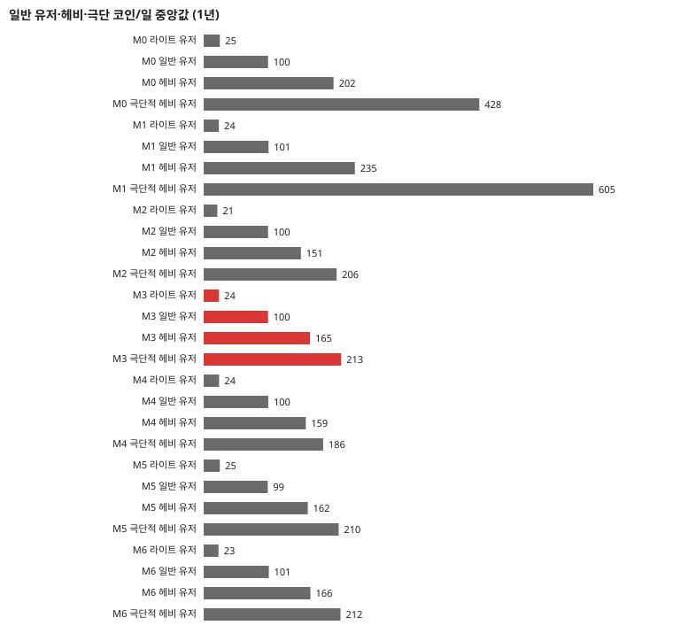
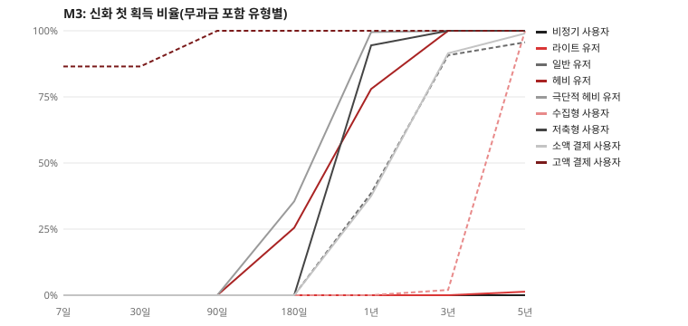
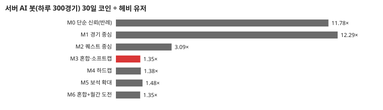

# 경제 연구 결과 (자동 생성)

> `scripts/economy/report.ts`가 `docs/economy/results/*.json`에서 생성. 손으로 고치지 말고 실험을 다시 실행하세요. 해석·추천은 [ECONOMY-RESEARCH.md](./ECONOMY-RESEARCH.md).

- 실행: 시드 20261124, 사용자 유형당 200명, 기간 7일·30일·90일·180일·1년·3년·5년, 실행 시간 793초.
- 코인 단위: 모든 모델의 코인 지급을 정규화해 **일반 유저(로그인·무과금)의 1년 중앙 획득량 = 100코인/일**. 보석은 정규화하지 않음. 보석 1개 ≈ 24.3코인(일반 유저 획득 시간 동등).
- 모든 사용자 행동 수치는 **가정**(실제 사용자 데이터 없음).

## 1. 실제 게임 데이터(숙련도 단계별 동형 대전)

엔진 `src/engine.ts` + DP Expert 행동가치 소프트맥스 정책(온도 τ). 시드 71000000~(경제 연구 개발용, 홀드아웃 아님). 단계당 20,000경기(=40,000 플레이어 기록), 교차 대전 쌍당 3,000경기(선후공 교대).

| 단계 | τ | 평균(표준편차) | p10/p50/p90 | 상단 보너스 | 요트 | 라지 | 200+ | 250+ | 270+ | 0점 없음 | 역전승(9R −30) |
|---|---|---|---|---|---|---|---|---|---|---|---|
| 입문 | 2.5 | 127.1 (33) | 87/123/172 | 19.1% | 8.2% | 63.6% | 2.2% | 0.05% | 0.00% | 0.20% | 1.08% |
| 초급 | 1.6 | 149.8 (35.5) | 106/146/195 | 34.4% | 13.4% | 70.7% | 8.0% | 0.41% | 0.05% | 1.07% | 1.81% |
| 중급 | 1 | 168.4 (36.7) | 121/167/215 | 48.9% | 19.2% | 74.6% | 18.8% | 1.62% | 0.27% | 2.59% | 2.16% |
| 숙련 | 0.5 | 184.9 (37.3) | 137/188/234 | 62.7% | 25.5% | 77.8% | 33.9% | 4.55% | 1.16% | 5.71% | 2.59% |
| 전문가(DP Expert) | 0 | 191.5 (37.8) | 142/193/242 | 68.8% | 28.2% | 78.1% | 41.4% | 6.91% | 2.09% | 7.70% | 2.65% |

교차 승리 점수율(행 기준, 무승부 0.5):

|  | 입문 | 초급 | 중급 | 숙련 | 전문가(DP Expert) |
|---|---|---|---|---|---|
| 입문 | 0.5 | 0.303 | 0.195 | 0.121 | 0.109 |
| 초급 | 0.697 | 0.5 | 0.355 | 0.227 | 0.217 |
| 중급 | 0.805 | 0.646 | 0.5 | 0.369 | 0.328 |
| 숙련 | 0.879 | 0.773 | 0.631 | 0.5 | 0.44 |
| 전문가(DP Expert) | 0.891 | 0.784 | 0.673 | 0.561 | 0.5 |

## 2. 희귀 사건: 정확 계산·중요도 표집

- DP Expert 정확 점수 분포: 질량 1, 평균 191.760879752 vs DP 테이블 191.760879752 (오차 1.4e-13), 계산 31초.

| 총점 ≥ | 150 | 180 | 200 | 220 | 250 | 270 | 280 | 290 | 300 | 310 | 320 | 323 |
|---|---|---|---|---|---|---|---|---|---|---|---|---|
| P (정확) | 85.57% | 64.54% | 41.53% | 21.56% | 7.03% | 2.14% | 0.32% | 1.51e-4 | 2.29e-6 | 6.65e-9 | 3.05e-13 | 4.41e-16 |
| 기대 경기 수 | 1 | 2 | 2 | 5 | 14 | 47 | 312 | 6,605 | 436,486 | 150,332,819 | 3,283,402,092,770 | 2,268,926,753,866,739 |

- 동급 DP Expert 1:1: 무승부 0.780%, 100점 이상 차 승리 3.17%, 150점 이상 0.188%.
- 첫 굴림 요트: 굴림당 7.72e-4, 경기당 ≥1 0.92%, ≥2 3.91e-5, ≥3 1.01e-7.
- 한 턴 최적 요트 4.60%, 6 요트 1.33%, 라지 26.11%.
- 목표 최적(그 목표만 노리는 플레이어) 경기 확률: 323점 완벽 3.21e-14, 상단 105점 4.56e-7, 0점 없는 경기 30.12%, 특수 족보 5종 모두 31.28%.

중요도 표집(교차 엔트로피로 면 분포 조정) 검증 — 몬테카를로 20,000경기와 정확값 비교:

| 임계값 | 정확 | MC | IS 추정(±SE) | 판정 |
|---|---|---|---|---|
| 250 | 7.03% | 6.92% | 7.20% ± 0.18% | 일치 |
| 270 | 2.14% | 2.08% | 1.99% ± 9.39e-4 | 일치 |
| 290 | 1.51e-4 | 2.50e-4 | 2.32e-4 ± 9.23e-5 | 일치 |

> 면 분포만 기울이는 IS(6개 매개변수)는 고득점이 특정 족보 조합(요트·스트레이트)에 의존해 효율이 낮다: 290점에서 상대오차 40%(첫 시험인 표본 1,000~2,000개에서는 290점 이상 적중 0). 그래서 극희귀 점수 업적(300·310·323점)은 **정확 분포**로 판정하고 IS는 교차 검증용으로만 쓴다.

## 3. 퀘스트 후보 달성 확률(일반 유저 경기 수, 중급 기준)

| 퀘스트 | 주기 | 난이도 | 경기당 p(중급) | 기대 경기 수(입문/중급/전문가) | 기간 내 달성(입문/중급/전문가) |
|---|---|---|---|---|---|
| 경기 3회 완료 | daily | 쉬움 | 100.0% | 3 / 3 / 3 | 77% / 77% / 77% |
| 풀 하우스 1회 기록 | daily | 쉬움 | 75.2% | 2 / 1.3 / 1.2 | 89% / 96% / 98% |
| 스몰 스트레이트 1회 기록 | daily | 쉬움 | 95.5% | 1.2 / 1 / 1 | 98% / 99% / 99% |
| 1승 | daily | 보통 | 50.0% | 2 / 2 / 2 | 89% / 89% / 89% |
| 상단 보너스 1회 달성 | daily | 보통 | 48.9% | 5.2 / 2 / 1.5 | 62% / 88% / 95% |
| 라지 스트레이트 2회 기록 | daily | 보통 | 74.7% | 3.1 / 2.7 / 2.6 | 76% / 80% / 81% |
| 180점 이상 1회 | daily | 보통 | 40.3% | 12.9 / 2.5 / 1.6 | 35% / 84% / 93% |
| 2승 | daily | 어려움 | 50.0% | 4 / 4 / 4 | 67% / 67% / 67% |
| 200점 이상 1회 | daily | 어려움 | 18.8% | 46.1 / 5.3 / 2.4 | 12% / 62% / 84% |
| 요트 1회 기록 | daily | 어려움 | 19.3% | 12.2 / 5.2 / 3.5 | 37% / 62% / 74% |
| 포커 2회 기록 | daily | 어려움 | 37.0% | 9.3 / 5.4 / 3.8 | 35% / 56% / 69% |
| 경기 15회 완료 | weekly | 쉬움 | 100.0% | 15 / 15 / 15 | 66% / 66% / 66% |
| 풀 하우스 8회 | weekly | 쉬움 | 75.2% | 15.6 / 10.6 / 9.5 | 69% / 80% / 83% |
| 7승 | weekly | 보통 | 50.0% | 14 / 14 / 14 | 72% / 72% / 72% |
| 상단 보너스 5회 | weekly | 보통 | 48.9% | 26.2 / 10.2 / 7.3 | 48% / 81% / 88% |
| 요트 2회 | weekly | 보통 | 19.3% | 24.4 / 10.4 / 7.1 | 55% / 81% / 89% |
| 220점 이상 2회 | weekly | 어려움 | 7.9% | 299.6 / 25.4 / 9.4 | 2% / 53% / 84% |
| 요트 4회 | weekly | 어려움 | 19.3% | 48.8 / 20.8 / 14.2 | 23% / 58% / 72% |
| 12승 | weekly | 어려움 | 50.0% | 24 / 24 / 24 | 50% / 50% / 50% |
| 경기 60회 완료 | monthly | 보통 | 100.0% | 60 / 60 / 60 | 66% / 66% / 66% |
| 요트 8회 | monthly | 어려움 | 19.3% | 97.7 / 41.6 / 28.4 | 53% / 81% / 88% |

## 4. 업적 후보(기대 경기 수·난이도·보상)

보상 보석 = 1.5·√(중급 기대 경기 수), 상한 100(상징 등급은 업적 전용 아이템 추가). 1년 달성률은 M3 시뮬레이션.

| 업적 | 분류 | 경기당 p(중급) | 기대 경기 수(입문/중급/전문가) | 난이도 | 보석 | 1년 달성 라이트/일반/헤비/극단 |
|---|---|---|---|---|---|---|
| 경기 10회 완료 | cumulative | — | 10 / 10 / 10 | 쉬움 | 5 | 100% / 100% / 100% / 100% |
| 경기 100회 완료 | cumulative | — | 100 / 100 / 100 | 보통 | 15 | 100% / 100% / 100% / 100% |
| 경기 500회 완료 | cumulative | — | 500 / 500 / 500 | 어려움 | 30 | 0% / 100% / 100% / 100% |
| 경기 1000회 완료 | cumulative | — | 1,000 / 1,000 / 1,000 | 어려움 | 50 | 0% / 100% / 100% / 100% |
| 경기 5000회 완료 | cumulative | — | 5,000 / 5,000 / 5,000 | 매우 어려움 | 100 | 0% / 0% / 0% / 100% |
| 경기 10000회 완료 | cumulative | — | 10,000 / 10,000 / 10,000 | 매우 어려움 | 100 | 0% / 0% / 0% / 100% |
| 10승 | cumulative | — | 20 / 20 / 20 | 보통 | 5 | 100% / 100% / 100% / 100% |
| 100승 | cumulative | — | 200 / 200 / 200 | 어려움 | 20 | 100% / 100% / 100% / 100% |
| 500승 | cumulative | — | 1,000 / 1,000 / 1,000 | 어려움 | 50 | 0% / 100% / 100% / 100% |
| 2000승 | cumulative | — | 4,000 / 4,000 / 4,000 | 매우 어려움 | 90 | 0% / 0% / 100% / 100% |
| 요트 1회 | cumulative | 19.25% | 12 / 5 / 4 | 쉬움 | 5 | 100% / 100% / 100% / 100% |
| 요트 10회 | cumulative | — | 122 / 52 / 35 | 보통 | 10 | 100% / 100% / 100% / 100% |
| 요트 50회 | cumulative | — | 610 / 260 / 177 | 어려움 | 20 | 57% / 100% / 100% / 100% |
| 요트 200회 | cumulative | — | 2,441 / 1,039 / 709 | 매우 어려움 | 50 | 0% / 93% / 100% / 100% |
| 요트 1000회 | cumulative | — | 12,210 / 5,195 / 3,545 | 매우 어려움 | 100 | 0% / 0% / 59% / 100% |
| 상단 보너스 10회 | cumulative | — | 52 / 20 / 15 | 보통 | 5 | 0% / 0% / 0% / 0% |
| 상단 보너스 100회 | cumulative | — | 525 / 205 / 145 | 어려움 | 20 | 0% / 0% / 0% / 0% |
| 상단 보너스 500회 | cumulative | — | 2,624 / 1,023 / 727 | 매우 어려움 | 50 | 0% / 0% / 0% / 0% |
| 200점 이상 달성 | skill | 18.84% | 46 / 5 / 2 | 쉬움 | 5 | 100% / 100% / 100% / 100% |
| 200점 이상 25회 | skill | — | 1,153 / 133 / 60 | 어려움 | 15 | 71% / 100% / 100% / 100% |
| 250점 이상 달성 | skill | 1.62% | 2,105 / 62 / 14 | 보통 | 10 | 71% / 97% / 100% / 100% |
| 270점 이상 달성 | skill | 0.27% | ∞ / 370 / 48 | 어려움 | 30 | 31% / 80% / 100% / 100% |
| 0점 칸 없이 경기 완료 | skill | 2.59% | 500 / 39 / 13 | 보통 | 10 | 89% / 100% / 100% / 100% |
| 상단 모든 칸 3개 이상(정석 보너스) | skill | 3.00% | 140 / 33 / 14 | 보통 | 10 | 0% / 0% / 0% / 0% |
| 9라운드 후 30점 이상 뒤지다 역전승 | skill | 2.18% | 92 / 46 / 37 | 보통 | 10 | 100% / 100% / 100% / 100% |
| 온라인 무작위 대전 5연승 | skill | — | 62 / 62 / 62 | 보통 | 10 | 99% / 100% / 100% / 100% |
| 온라인 무작위 대전 10연승 | skill | — | 2,046 / 2,046 / 2,046 | 매우 어려움 | 70 | 12% / 35% / 77% / 98% |
| 첫 굴림 요트 | luck | 0.86% | 105 / 116 / 105 | 어려움 | 15 | 97% / 100% / 100% / 100% |
| 헥사 30점(6 다섯 개) | luck | 1.19% | 114 / 84 / 68 | 보통 | 15 | 99% / 100% / 100% / 100% |
| 마지막 라운드 요트 | luck | 8.25e-4 | 5,714 / 1,212 / 253 | 매우 어려움 | 50 | 17% / 64% / 95% / 100% |
| 첫 굴림 라지 스트레이트 10회 | luck | — | 27 / 27 / 27 | 보통 | 10 | 100% / 100% / 100% / 100% |
| 한 경기 첫 굴림 요트 2회 | special | 3.91e-5 | 25,580 / 25,580 / 25,580 | 극한 | 100+특수 | 3% / 5% / 16% / 20% |
| 300점 이상 | special | 0 | ∞ / ∞ / 436,500 | 극한 | 100+특수 | 0% / 0% / 0% / 1% |
| 한 경기 첫 굴림 요트 3회 | special | 1.01e-7 | 9.9e+6 / 9.9e+6 / 9.9e+6 | 상징(사실상 불가능) | 100+특수 | 0% / 0% / 0% / 0% |
| 310점 이상 | special | 0 | ∞ / ∞ / 1.5e+8 | 상징(사실상 불가능) | 100+특수 | 0% / 0% / 0% / 0% |
| 323점 완벽한 경기 | special | 0 | ∞ / ∞ / 2.3e+15 | 상징(사실상 불가능) | 100+특수 | 0% / 0% / 0% / 0% |
| 1~6 모든 눈으로 요트 | collection | — | 198 / 90 / 58 | 보통 | 15 | 98% / 100% / 100% / 100% |
| 서버 검증 경기를 한 날 30일 | collection | — | 180 / 180 / 180 | 어려움 | 20 | 100% / 100% / 100% / 100% |
| 서버 검증 경기를 한 날 100일 | collection | — | 600 / 600 / 600 | 어려움 | 40 | 99% / 100% / 100% / 100% |
| 서버 검증 경기를 한 날 365일 | collection | — | 2,190 / 2,190 / 2,190 | 매우 어려움 | 70 | 0% / 0% / 0% / 0% |
| 서버 검증 경기를 한 날 1000일 | collection | — | 6,000 / 6,000 / 6,000 | 매우 어려움 | 100 | 0% / 0% / 0% / 0% |
| 일일 퀘스트 30회 완료 | collection | — | 375 / 375 / 375 | 어려움 | 30 | 48% / 100% / 100% / 100% |
| 일일 퀘스트 180회 완료 | collection | — | 2,250 / 2,250 / 2,250 | 매우 어려움 | 70 | 0% / 64% / 100% / 100% |
| 일일 퀘스트 365회 완료 | collection | — | 4,563 / 4,563 / 4,563 | 매우 어려움 | 100 | 0% / 0% / 0% / 0% |

## 5. 모델 정규화

| 모델 | 설명 | 원래 일반 유저 코인/일 | 정규화 배수 | 일반 유저 보석/일 |
|---|---|---|---|---|
| M0 단순 신뢰(반례) | 모든 모드(로컬 AI 포함 클라이언트 기록)에 보상, 상한 없음. 어뷰징 위험을 측정하기 위한 반례 — 채택 후보 아님. | 251.2 | 0.398 | 4.23 |
| M1 경기 중심 | 경기 보상이 주 수급원(완료+승리), 퀘스트는 작게, 상한 없음. 많이 할수록 선형으로 더 받음. | 254.7 | 0.393 | 4.12 |
| M2 퀘스트 중심 | 경기당 보상은 작고 일일·주간 퀘스트가 주 수급원. 하루 소수 경기로 대부분 획득. | 375 | 0.267 | 4.12 |
| M3 혼합·소프트캡 | 경기 보상 + 퀘스트 균형, 하루 10경기 이후 경기 코인 25%, 30경기 이후 경기 코인 0(퀘스트는 계속, 업적 진행은 하루 40경기까지). 친구 대전은 승리 보상 없음·일 10경기. | 226 | 0.442 | 4.12 |
| M4 하드캡 | M3와 같으나 경기 코인 하루 상한(소프트캡 없음). 상한 이후 경기 코인 0. | 224.5 | 0.445 | 4.12 |
| M5 보석 확대 | M3 + 일일 보석·주간 보석·업적 보석 2배. 보석 희소성 유지 여부를 시험. | 243.4 | 0.411 | 12.36 |
| M6 혼합+월간 도전 | M3 + 월간 도전(한 달에 일일 퀘스트를 15일 이상 완료 시 보석·코인). 장기 복귀 동기 시험. | 234.4 | 0.427 | 4.54 |

## 6. 모델 × 사용자 유형 (1년, 로그인 사용자)

**코인/일 중앙값 (p10~p90, 최소)**

| 유형 | M0 | M1 | M2 | M3 | M4 | M5 | M6 |
|---|---|---|---|---|---|---|---|
| 비정기 사용자 | 7 (6~9, 4) | 6 (5~8, 3) | 4 (3~7, 2) | 6 (4~7, 3) | 6 (4~7, 3) | 7 (5~9, 3) | 6 (4~7, 3) |
| 라이트 유저 | 25 (20~31, 17) | 24 (20~29, 18) | 21 (16~29, 11) | 24 (19~30, 16) | 24 (20~31, 16) | 25 (20~32, 17) | 23 (19~30, 15) |
| 일반 유저 | 100 (94~106, 86) | 101 (94~106, 89) | 100 (88~108, 76) | 100 (93~106, 81) | 100 (93~106, 85) | 99 (91~105, 84) | 101 (91~107, 82) |
| 헤비 유저 | 202 (195~208, 189) | 235 (223~244, 214) | 151 (146~154, 139) | 165 (162~168, 154) | 159 (155~161, 149) | 162 (158~165, 153) | 166 (162~169, 155) |
| 극단적 헤비 유저 | 428 (416~442, 402) | 605 (584~625, 564) | 206 (204~209, 201) | 213 (211~215, 209) | 186 (184~187, 182) | 210 (207~212, 205) | 212 (211~214, 209) |
| 수집형 사용자 | 126 (120~132, 109) | 132 (125~139, 116) | 119 (107~124, 88) | 121 (115~126, 106) | 121 (114~126, 107) | 119 (112~124, 104) | 123 (115~129, 102) |
| 저축형 사용자 | 100 (93~105, 87) | 100 (95~106, 88) | 101 (88~108, 73) | 100 (93~106, 82) | 100 (92~106, 82) | 99 (91~106, 83) | 101 (91~107, 80) |
| 소액 결제 사용자 | 112 (106~118, 98) | 117 (110~122, 106) | 110 (95~117, 81) | 111 (103~116, 95) | 111 (102~116, 92) | 110 (101~114, 94) | 112 (102~119, 90) |
| 고액 결제 사용자 | 810 (702~867, 534) | 821 (717~879, 602) | 784 (676~848, 521) | 798 (696~855, 580) | 795 (689~853, 629) | 794 (685~852, 628) | 799 (691~856, 582) |

**보석/일 중앙값**

| 유형 | M0 | M1 | M2 | M3 | M4 | M5 | M6 |
|---|---|---|---|---|---|---|---|
| 비정기 사용자 | 0.44 | 0.36 | 0.35 | 0.38 | 0.38 | 0.97 | 0.38 |
| 라이트 유저 | 1.23 | 1.13 | 1.11 | 1.15 | 1.14 | 3.25 | 1.13 |
| 일반 유저 | 4.24 | 4.09 | 4.12 | 4.13 | 4.14 | 12.43 | 4.59 |
| 헤비 유저 | 5.72 | 5.66 | 5.52 | 5.55 | 5.64 | 17.2 | 6.2 |
| 극단적 헤비 유저 | 6.39 | 6.38 | 6.38 | 6.38 | 6.38 | 19.36 | 7.04 |
| 수집형 사용자 | 4.7 | 4.66 | 4.64 | 4.62 | 4.64 | 14.14 | 5.27 |
| 저축형 사용자 | 4.23 | 4.14 | 4.17 | 4.15 | 4.16 | 12.46 | 4.59 |
| 소액 결제 사용자 | 6.15 | 6 | 6.04 | 5.98 | 6.04 | 15.07 | 6.56 |
| 고액 결제 사용자 | 54.25 | 54.09 | 53.92 | 54.19 | 54.06 | 64.36 | 54.83 |

**신화 첫 획득 비율 / 최대 강화(Lv.3) 아이템 보유 비율**

| 유형 | M0 | M1 | M2 | M3 | M4 | M5 | M6 |
|---|---|---|---|---|---|---|---|
| 비정기 사용자 | 0% / 3% | 0% / 0% | 0% / 1% | 0% / 1% | 0% / 1% | 0% / 0% | 0% / 0% |
| 라이트 유저 | 0% / 11% | 0% / 11% | 0% / 8% | 0% / 11% | 0% / 10% | 0% / 1% | 0% / 11% |
| 일반 유저 | 38% / 7% | 37% / 8% | 36% / 8% | 37% / 7% | 38% / 6% | 81% / 5% | 42% / 7% |
| 헤비 유저 | 83% / 49% | 71% / 57% | 61% / 34% | 66% / 37% | 64% / 38% | 99% / 1% | 92% / 28% |
| 극단적 헤비 유저 | 100% / 92% | 100% / 100% | 100% / 37% | 100% / 40% | 100% / 36% | 100% / 2% | 100% / 23% |
| 수집형 사용자 | 0% / 69% | 0% / 76% | 0% / 34% | 0% / 53% | 0% / 49% | 89% / 0% | 0% / 39% |
| 저축형 사용자 | 94% / 0% | 94% / 0% | 94% / 0% | 93% / 0% | 93% / 0% | 100% / 0% | 93% / 0% |
| 소액 결제 사용자 | 41% / 99% | 38% / 99% | 33% / 99% | 38% / 99% | 38% / 99% | 91% / 89% | 44% / 99% |
| 고액 결제 사용자 | 100% / 100% | 100% / 100% | 100% / 100% | 100% / 100% | 100% / 100% | 100% / 100% | 100% / 100% |

## 7. 추천 모델 M3 — 기간별 상세

**비정기 사용자**

| 기간 | 코인/일(중앙·p10·p90·최소) | 주간 | 월간 | 보석/월 | 잔액 코인(중앙·p90·최대) | 보석 잔액 | 등급 첫 획득 비율(일반→신화) | 중앙 일수(일반→신화) | 최대 강화 | 신화 최대 강화 | 잔액 지니 |
|---|---|---|---|---|---|---|---|---|---|---|---|
| 7일 | 30 · 21 · 41 · 19 | 212 | 909 | 107.1 | 149 · 215 · 286 | 25 | 44%/0%/0%/0%/0% | 2/—/—/—/— | 0% | 0% | 0.12 |
| 30일 | 11 · 7 · 19 · 6 | 80 | 342 | 31 | 118 · 186 · 290 | 30 | 83%/0%/0%/0%/0% | 7/—/—/—/— | 0% | 0% | 0.22 |
| 90일 | 8 · 4 · 11 · 3 | 53 | 225 | 19 | 100 · 231 · 292 | 39 | 100%/0%/0%/0%/0% | 9/—/—/—/— | 1% | 0% | 0.28 |
| 180일 | 6 · 4 · 8 · 3 | 44 | 190 | 13.5 | 121 · 285 · 391 | 63 | 100%/1%/0%/0%/0% | 9/173/—/—/— | 1% | 0% | 0.27 |
| 1년 | 6 · 4 · 7 · 3 | 41 | 176 | 11.3 | 192 · 441 · 595 | 66 | 100%/25%/0%/0%/0% | 9/252/—/—/— | 1% | 0% | 0.31 |
| 3년 | 5 · 4 · 6 · 4 | 36 | 154 | 7.6 | 347 · 908 · 1,271 | 88 | 100%/68%/0%/0%/0% | 9/466/—/—/— | 1% | 0% | 0.31 |
| 5년 | 5 · 4 · 6 · 4 | 34 | 145 | 5.6 | 578 · 1,281 · 1,704 | 97 | 100%/74%/0%/0%/0% | 9/547/—/—/— | 2% | 0% | 0.28 |

**라이트 유저**

| 기간 | 코인/일(중앙·p10·p90·최소) | 주간 | 월간 | 보석/월 | 잔액 코인(중앙·p90·최대) | 보석 잔액 | 등급 첫 획득 비율(일반→신화) | 중앙 일수(일반→신화) | 최대 강화 | 신화 최대 강화 | 잔액 지니 |
|---|---|---|---|---|---|---|---|---|---|---|---|
| 7일 | 51 · 26 · 100 · 20 | 357 | 1,530 | 150 | 153 · 263 · 378 | 32 | 78%/1%/0%/0%/0% | 2/5/—/—/— | 0% | 0% | 0.24 |
| 30일 | 34 · 21 · 51 · 14 | 237 | 1,014 | 80 | 157 · 320 · 710 | 66 | 100%/5%/0%/0%/0% | 3/26/—/—/— | 1% | 0% | 0.29 |
| 90일 | 27 · 19 · 39 · 13 | 190 | 816 | 52.7 | 237 · 593 · 1,229 | 95 | 100%/40%/0%/0%/0% | 3/67/—/—/— | 6% | 0% | 0.29 |
| 180일 | 25 · 19 · 33 · 17 | 176 | 753 | 40.2 | 440 · 919 · 1,396 | 108 | 100%/85%/0%/0%/0% | 3/93/—/—/— | 9% | 0% | 0.28 |
| 1년 | 24 · 19 · 30 · 16 | 166 | 713 | 34.5 | 694 · 1,804 · 3,758 | 172 | 100%/100%/1%/0%/0% | 3/101/296/—/— | 11% | 0% | 0.32 |
| 3년 | 22 · 19 · 27 · 15 | 155 | 664 | 24.1 | 5,644 · 8,216 · 10,238 | 273 | 100%/100%/11%/17%/0% | 3/101/740/893/— | 15% | 0% | 0.29 |
| 5년 | 22 · 18 · 25 · 15 | 151 | 646 | 20 | 8,651 · 12,439 · 15,390 | 336 | 100%/100%/20%/36%/1% | 3/101/1,058/1,161/1,821 | 15% | 0% | 0.3 |

**일반 유저**

| 기간 | 코인/일(중앙·p10·p90·최소) | 주간 | 월간 | 보석/월 | 잔액 코인(중앙·p90·최대) | 보석 잔액 | 등급 첫 획득 비율(일반→신화) | 중앙 일수(일반→신화) | 최대 강화 | 신화 최대 강화 | 잔액 지니 |
|---|---|---|---|---|---|---|---|---|---|---|---|
| 7일 | 171 · 109 · 222 · 77 | 1,199 | 5,139 | 390 | 274 · 574 · 861 | 88 | 88%/1%/0%/0%/0% | 2/6/—/—/— | 0% | 0% | 0.19 |
| 30일 | 120 · 99 · 139 · 68 | 840 | 3,600 | 228 | 563 · 973 · 1,709 | 187 | 98%/38%/0%/0%/0% | 2/25/—/—/— | 1% | 0% | 0.14 |
| 90일 | 109 · 95 · 120 · 77 | 762 | 3,267 | 170 | 1,552 · 2,894 · 3,783 | 316 | 100%/98%/1%/0%/0% | 2/34/87/—/— | 4% | 0% | 0.16 |
| 180일 | 103 · 93 · 112 · 85 | 724 | 3,102 | 137.3 | 9,111 · 10,015 · 11,214 | 490 | 100%/100%/21%/14%/0% | 2/35/148/145/— | 5% | 0% | 0.2 |
| 1년 | 100 · 93 · 106 · 81 | 699 | 2,997 | 124 | 4,759 · 18,137 · 21,072 | 319 | 100%/100%/83%/36%/37% | 2/35/258/213/294 | 7% | 0% | 0.4 |
| 3년 | 97 · 91 · 101 · 86 | 676 | 2,897 | 98.8 | 7,072 · 13,406 · 28,509 | 293 | 100%/100%/100%/91%/91% | 2/35/282/455/464 | 22% | 3% | 0.29 |
| 5년 | 96 · 90 · 99 · 85 | 672 | 2,881 | 93.5 | 13,285 · 35,126 · 51,135 | 345 | 100%/100%/100%/99%/95% | 2/35/282/488/476 | 42% | 23% | 0.36 |

**헤비 유저**

| 기간 | 코인/일(중앙·p10·p90·최소) | 주간 | 월간 | 보석/월 | 잔액 코인(중앙·p90·최대) | 보석 잔액 | 등급 첫 획득 비율(일반→신화) | 중앙 일수(일반→신화) | 최대 강화 | 신화 최대 강화 | 잔액 지니 |
|---|---|---|---|---|---|---|---|---|---|---|---|
| 7일 | 290 · 237 · 338 · 188 | 2,031 | 8,703 | 737.1 | 484 · 886 · 1,256 | 166 | 99%/6%/0%/0%/0% | 1/6/—/—/— | 0% | 0% | 0.12 |
| 30일 | 199 · 183 · 212 · 168 | 1,392 | 5,967 | 348 | 958 · 1,447 · 2,492 | 229 | 99%/98%/0%/0%/0% | 1/13/—/—/— | 0% | 0% | 0.11 |
| 90일 | 183 · 175 · 191 · 153 | 1,282 | 5,496 | 273 | 7,618 · 8,547 · 8,882 | 509 | 100%/100%/8%/2%/0% | 1/14/82/86/— | 0% | 0% | 0.08 |
| 180일 | 171 · 167 · 175 · 159 | 1,194 | 5,115 | 194.8 | 14,932 · 15,957 · 17,039 | 679 | 100%/100%/55%/5%/23% | 1/14/162/121/170 | 4% | 0% | 0.26 |
| 1년 | 165 · 162 · 168 · 154 | 1,155 | 4,950 | 166.6 | 9,168 · 30,199 · 32,590 | 344 | 100%/100%/99%/25%/66% | 1/14/174/320/289 | 37% | 0% | 0.44 |
| 3년 | 160 · 158 · 162 · 155 | 1,119 | 4,797 | 132.8 | 12,734 · 19,488 · 35,677 | 369 | 100%/100%/100%/97%/100% | 1/14/176/404/329 | 39% | 2% | 0.21 |
| 5년 | 158 · 156 · 160 · 154 | 1,105 | 4,734 | 120.3 | 25,579 · 42,749 · 67,224 | 490 | 100%/100%/100%/100%/100% | 1/14/176/409/329 | 64% | 35% | 0.26 |

**극단적 헤비 유저**

| 기간 | 코인/일(중앙·p10·p90·최소) | 주간 | 월간 | 보석/월 | 잔액 코인(중앙·p90·최대) | 보석 잔액 | 등급 첫 획득 비율(일반→신화) | 중앙 일수(일반→신화) | 최대 강화 | 신화 최대 강화 | 잔액 지니 |
|---|---|---|---|---|---|---|---|---|---|---|---|
| 7일 | 401 · 353 · 441 · 308 | 2,806 | 12,027 | 1,144.2 | 473 · 1,017 · 1,578 | 197 | 100%/68%/0%/0%/0% | 1/6/—/—/— | 0% | 0% | 0.13 |
| 30일 | 268 · 249 · 287 · 233 | 1,875 | 8,037 | 530.1 | 1,073 · 1,731 · 2,916 | 350 | 100%/100%/1%/0%/0% | 1/7/30/—/— | 0% | 0% | 0.1 |
| 90일 | 231 · 226 · 235 · 220 | 1,616 | 6,927 | 299 | 10,447 · 10,683 · 11,282 | 538 | 100%/100%/10%/0%/0% | 1/7/72/—/— | 0% | 0% | 0.06 |
| 180일 | 224 · 221 · 227 · 219 | 1,567 | 6,714 | 255.2 | 17,187 · 20,624 · 21,789 | 909 | 100%/100%/64%/4%/23% | 1/7/130/160/128 | 33% | 0% | 0.2 |
| 1년 | 213 · 211 · 215 · 209 | 1,494 | 6,402 | 191.3 | 8,421 · 12,965 · 24,623 | 260 | 100%/100%/100%/39%/100% | 1/7/150/297/274 | 40% | 0% | 0.26 |
| 3년 | 205 · 204 · 206 · 203 | 1,436 | 6,156 | 141 | 15,475 · 21,723 · 32,264 | 374 | 100%/100%/100%/100%/100% | 1/7/150/460/274 | 44% | 4% | 0.21 |
| 5년 | 203 · 202 · 204 · 201 | 1,420 | 6,084 | 124.8 | 33,376 · 45,149 · 75,935 | 601 | 100%/100%/100%/100%/100% | 1/7/150/460/274 | 95% | 88% | 0.22 |

**수집형 사용자**

| 기간 | 코인/일(중앙·p10·p90·최소) | 주간 | 월간 | 보석/월 | 잔액 코인(중앙·p90·최대) | 보석 잔액 | 등급 첫 획득 비율(일반→신화) | 중앙 일수(일반→신화) | 최대 강화 | 신화 최대 강화 | 잔액 지니 |
|---|---|---|---|---|---|---|---|---|---|---|---|
| 7일 | 194 · 148 · 245 · 82 | 1,357 | 5,817 | 462.9 | 234 · 381 · 513 | 64 | 100%/1%/0%/0%/0% | 1/5/—/—/— | 0% | 0% | 0.24 |
| 30일 | 143 · 118 · 166 · 97 | 1,000 | 4,284 | 271 | 580 · 967 · 1,181 | 107 | 100%/91%/0%/0%/0% | 1/19/—/—/— | 0% | 0% | 0.18 |
| 90일 | 131 · 119 · 142 · 101 | 915 | 3,921 | 196.3 | 1,421 · 2,228 · 2,788 | 175 | 100%/100%/0%/0%/0% | 1/20/—/—/— | 0% | 0% | 0.12 |
| 180일 | 127 · 119 · 134 · 105 | 890 | 3,816 | 173.7 | 4,836 · 5,262 · 5,562 | 269 | 100%/100%/0%/0%/0% | 1/20/—/—/— | 0% | 0% | 0.07 |
| 1년 | 121 · 115 · 126 · 106 | 849 | 3,639 | 138.7 | 9,051 · 9,531 · 9,899 | 398 | 100%/100%/14%/0%/0% | 1/20/353/—/— | 53% | 0% | 0.05 |
| 3년 | 119 · 113 · 121 · 105 | 830 | 3,555 | 117.8 | 25,510 · 26,655 · 27,228 | 970 | 100%/100%/100%/0%/0% | 1/20/416/—/— | 87% | 0% | 0.06 |
| 5년 | 117 · 112 · 120 · 106 | 821 | 3,519 | 108.3 | 11,695 · 15,520 · 17,768 | 464 | 100%/100%/100%/0%/100% | 1/20/416/—/1,325 | 87% | 0% | 0.14 |

**저축형 사용자**

| 기간 | 코인/일(중앙·p10·p90·최소) | 주간 | 월간 | 보석/월 | 잔액 코인(중앙·p90·최대) | 보석 잔액 | 등급 첫 획득 비율(일반→신화) | 중앙 일수(일반→신화) | 최대 강화 | 신화 최대 강화 | 잔액 지니 |
|---|---|---|---|---|---|---|---|---|---|---|---|
| 7일 | 169 · 121 · 223 · 63 | 1,182 | 5,067 | 385.8 | 412 · 859 · 1,559 | 90 | 0%/0%/0%/0%/0% | —/—/—/—/— | 0% | 0% | 0.17 |
| 30일 | 118 · 98 · 138 · 79 | 825 | 3,534 | 228 | 602 · 1,028 · 1,762 | 228 | 0%/0%/0%/0%/0% | —/—/—/—/— | 0% | 0% | 0.11 |
| 90일 | 110 · 97 · 119 · 85 | 768 | 3,291 | 173 | 3,072 · 3,941 · 5,082 | 519 | 0%/0%/0%/0%/0% | —/—/—/—/— | 0% | 0% | 0.08 |
| 180일 | 103 · 94 · 111 · 87 | 719 | 3,081 | 138.5 | 11,689 · 13,091 · 13,952 | 831 | 0%/0%/0%/0%/0% | —/—/—/—/— | 0% | 0% | 0.06 |
| 1년 | 100 · 93 · 106 · 82 | 700 | 2,999 | 124.6 | 12,137 · 14,821 · 28,711 | 344 | 0%/0%/0%/0%/93% | —/—/—/—/265 | 0% | 0% | 0.29 |
| 3년 | 97 · 91 · 101 · 82 | 677 | 2,903 | 98.9 | 10,326 · 16,496 · 27,338 | 757 | 0%/0%/3%/47%/100% | —/—/850/856/269 | 0% | 0% | 0.17 |
| 5년 | 96 · 91 · 99 · 82 | 674 | 2,889 | 93.8 | 5,685 · 11,146 · 20,343 | 417 | 0%/0%/3%/47%/100% | —/—/850/856/269 | 100% | 100% | 0.26 |

**소액 결제 사용자**

| 기간 | 코인/일(중앙·p10·p90·최소) | 주간 | 월간 | 보석/월 | 잔액 코인(중앙·p90·최대) | 보석 잔액 | 등급 첫 획득 비율(일반→신화) | 중앙 일수(일반→신화) | 최대 강화 | 신화 최대 강화 | 잔액 지니 |
|---|---|---|---|---|---|---|---|---|---|---|---|
| 7일 | 191 · 132 · 230 · 78 | 1,334 | 5,718 | 621.3 | 543 · 731 · 965 | 30 | 100%/1%/0%/0%/0% | 1/3/—/—/— | 2% | 0% | 0.3 |
| 30일 | 134 · 114 · 154 · 92 | 937 | 4,014 | 299 | 887 · 1,482 · 2,070 | 61 | 100%/2%/0%/0%/0% | 1/20/—/—/— | 6% | 0% | 0.23 |
| 90일 | 120 · 108 · 130 · 93 | 840 | 3,600 | 229 | 4,569 · 4,970 · 5,476 | 300 | 100%/26%/0%/0%/0% | 1/81/—/—/— | 69% | 0% | 0.12 |
| 180일 | 115 · 106 · 122 · 97 | 805 | 3,450 | 196 | 8,558 · 9,328 · 10,324 | 420 | 100%/100%/3%/5%/0% | 1/101/168/151/— | 90% | 0% | 0.14 |
| 1년 | 111 · 103 · 116 · 95 | 776 | 3,327 | 179.5 | 11,454 · 17,163 · 18,247 | 311 | 100%/100%/54%/13%/38% | 1/102/311/188/319 | 99% | 0% | 0.4 |
| 3년 | 108 · 102 · 112 · 95 | 756 | 3,240 | 160.2 | 8,430 · 14,819 · 52,649 | 197 | 100%/100%/100%/63%/91% | 1/102/343/780/446 | 99% | 0% | 0.41 |
| 5년 | 107 · 101 · 109 · 95 | 747 | 3,201 | 150.1 | 28,092 · 39,464 · 76,786 | 370 | 100%/100%/100%/99%/98% | 1/102/343/994/471 | 99% | 2% | 0.23 |

**고액 결제 사용자**

| 기간 | 코인/일(중앙·p10·p90·최소) | 주간 | 월간 | 보석/월 | 잔액 코인(중앙·p90·최대) | 보석 잔액 | 등급 첫 획득 비율(일반→신화) | 중앙 일수(일반→신화) | 최대 강화 | 신화 최대 강화 | 잔액 지니 |
|---|---|---|---|---|---|---|---|---|---|---|---|
| 7일 | 3,086 · 279 · 3,135 · 176 | 21,602 | 92,580 | 6,963 | 753 · 1,230 · 1,954 | 39 | 100%/87%/87%/0%/87% | 1/1/1/—/1 | 1% | 0% | 0.27 |
| 30일 | 836 · 184 · 855 · 147 | 5,855 | 25,092 | 1,812 | 1,353 · 2,229 · 3,164 | 81 | 100%/87%/87%/0%/87% | 1/1/1/—/1 | 5% | 0% | 0.2 |
| 90일 | 818 · 593 · 828 · 156 | 5,724 | 24,531 | 1,703.4 | 12,860 · 14,844 · 16,203 | 174 | 100%/100%/100%/95%/100% | 1/1/1/31/1 | 5% | 0% | 0.19 |
| 180일 | 712 · 595 · 819 · 478 | 4,987 | 21,372 | 1,452.6 | 12,741 · 21,652 · 39,931 | 875 | 100%/100%/100%/100%/100% | 1/1/1/31/1 | 84% | 81% | 0.28 |
| 1년 | 798 · 696 · 855 · 580 | 5,585 | 23,934 | 1,625.7 | 8,057 · 13,722 · 19,999 | 5,410 | 100%/100%/100%/100%/100% | 1/1/1/31/1 | 100% | 100% | 0.13 |
| 3년 | 742 · 704 · 781 · 632 | 5,195 | 22,266 | 1,483.2 | 2,775 · 8,714 · 20,187 | 21,930 | 100%/100%/100%/100%/100% | 1/1/1/31/1 | 100% | 100% | 0.07 |
| 5년 | 740 · 703 · 765 · 677 | 5,177 | 22,188 | 1,471.5 | 31,258 · 36,114 · 39,236 | 36,654 | 100%/100%/100%/100%/100% | 1/1/1/31/1 | 100% | 100% | 0.05 |

## 8. 수급처 비중(일반 유저, 전체 기간 누적)

| 모델 | 경기 코인 | 일일 퀘스트 코인 | 주간 퀘스트 코인 | 월간 도전 코인 | 업적 코인 | 특별 이벤트 코인 | 신규 사용자 코인 | 현금 구매 코인 | 업적 보석 | 주간 보석 | 일일 보석 | 이벤트 보석 |
|---|---|---|---|---|---|---|---|---|---|---|---|---|
| M0 | 42% | 26% | 27% | 0% | 3% | 2% | 0% | 0% | 22% | 54% | 16% | 7% |
| M1 | 68% | 15% | 12% | 0% | 3% | 2% | 0% | 0% | 23% | 53% | 16% | 8% |
| M2 | 8% | 46% | 42% | 0% | 2% | 1% | 0% | 0% | 23% | 53% | 16% | 8% |
| M3 | 37% | 29% | 29% | 0% | 3% | 2% | 0% | 0% | 23% | 53% | 16% | 8% |
| M4 | 36% | 29% | 29% | 0% | 3% | 2% | 0% | 0% | 23% | 53% | 16% | 8% |
| M5 | 36% | 27% | 28% | 0% | 6% | 2% | 0% | 0% | 14% | 42% | 37% | 7% |
| M6 | 36% | 28% | 28% | 3% | 3% | 2% | 0% | 0% | 20% | 47% | 15% | 7% |

## 9. 어뷰징(30일, 헤비 유저 중앙값 대비 코인 배수)

| 모델 | 어뷰징 사용자(서버 AI 봇) (23h/일) | 승리 거래(친구 대전 2계정) (8h/일) | 로컬 AI 기록 위조 (75h/일) | 온라인 무작위 대전 봇(24시간) (24h/일) | 극단 헤비/헤비 | 다중 계정 신규 보상(이전 불가) |
|---|---|---|---|---|---|---|
| M0 | 11.9× (보석 2.62×) | 4.41× (보석 1.79×) | 15.95× (보석 4.06×) | 7.18× (보석 2.85×) | 2.14 | 119코인+20보석/계정 |
| M1 | 12.54× (보석 2.62×) | 0.84× (보석 1.24×) | 0.02× (보석 0.06×) | 11.54× (보석 2.85×) | 2.53 | 118코인+20보석/계정 |
| M2 | 3.11× (보석 2.62×) | 1.05× (보석 1.24×) | 0.02× (보석 0.06×) | 3.29× (보석 2.85×) | 1.45 | 80코인+20보석/계정 |
| M3 | 1.33× (보석 1.79×) | 1.07× (보석 1.24×) | 0.02× (보석 0.06×) | 1.66× (보석 2.02×) | 1.38 | 133코인+20보석/계정 |
| M4 | 1.36× (보석 1.79×) | 1.1× (보석 1.24×) | 0.02× (보석 0.06×) | 1.42× (보석 2.02×) | 1.27 | 134코인+20보석/계정 |
| M5 | 1.43× (보석 1.63×) | 1.1× (보석 1.2×) | 0.02× (보석 0.06×) | 1.76× (보석 1.81×) | 1.42 | 123코인+50보석/계정 |
| M6 | 1.32× (보석 1.74×) | 1.06× (보석 1.23×) | 0.02× (보석 0.05×) | 1.64× (보석 1.96×) | 1.36 | 128코인+20보석/계정 |

## 10. 강화 곡선 비교

단계별 비용(가격 × 기준 비율 0.5 × 곡선 배수), 신화 기준 Lv1→2 / Lv2→3 (확장 시 Lv3→4 / Lv4→5):

| 곡선 | 일반 Lv1→2 / 2→3 | 고급 Lv1→2 / 2→3 | 영웅 Lv1→2 / 2→3 | 전설 Lv1→2 / 2→3 | 신화 Lv1→2 / 2→3 | 신화 Lv3→4 / 4→5(확장) |
|---|---|---|---|---|---|---|
| 선형 | 100 / 200 | 300 / 600 | 1,000 / 2,000 | 3,000 / 6,000 | 8,000 / 15,000 | 20,000 / 30,000 |
| 기하급수 | 100 / 300 | 300 / 800 | 1,000 / 3,000 | 3,000 / 8,000 | 8,000 / 20,000 | 60,000 / 200,000 |
| 멱함수 | 100 / 600 | 300 / 1,500 | 1,000 / 6,000 | 3,000 / 15,000 | 8,000 / 40,000 | 120,000 / 250,000 |
| 구간별 | 100 / 300 | 300 / 800 | 1,000 / 3,000 | 3,000 / 8,000 | 8,000 / 20,000 | 60,000 / 150,000 |

1년 시뮬레이션(M3, 무과금·로그인):

| 곡선 | 기준 비율 | 신화 Lv1→2 / 2→3 | 일반: 최대 강화 보유 | 헤비: 신화 최대 강화 | 극단: 신화 최대 강화 | 헤비 지출 중 강화 | 일반: 신화 획득 |
|---|---|---|---|---|---|---|---|
| linear | 0.25 | 4,000 / 8,000 | 62% | 1% | 0% | 13% | 38% |
| linear | 0.5 | 8,000 / 15,000 | 7% | 0% | 0% | 13% | 38% |
| linear | 1 | 15,000 / 30,000 | 6% | 0% | 0% | 3% | 38% |
| exponential | 0.25 | 4,000 / 12,000 | 56% | 0% | 0% | 12% | 38% |
| exponential | 0.5 | 8,000 / 20,000 | 7% | 0% | 0% | 13% | 38% |
| exponential | 1 | 15,000 / 40,000 | 1% | 0% | 0% | 1% | 38% |
| power | 0.25 | 4,000 / 20,000 | 6% | 0% | 0% | 9% | 38% |
| power | 0.5 | 8,000 / 40,000 | 6% | 0% | 0% | 13% | 38% |
| power | 1 | 15,000 / 80,000 | 0% | 0% | 0% | 1% | 38% |
| piecewise | 0.25 | 4,000 / 12,000 | 56% | 0% | 0% | 12% | 38% |
| piecewise | 0.5 | 8,000 / 20,000 | 7% | 0% | 0% | 13% | 38% |
| piecewise | 1 | 15,000 / 40,000 | 1% | 0% | 0% | 1% | 38% |

## 11. 민감도 분석(M3, 무과금)

| 가정 | 값 | 일반 6개월 신화 | 일반 1년 신화 | 헤비 6개월 신화 | 라이트 1년 신화 | 비정기 1년 신화 | 일반 코인/일 | 일반 보석/일 | 일반 1년 잔액 |
|---|---|---|---|---|---|---|---|---|---|
| 기준 | M3 기본값 | 0% | 38% | 23% | 0% | 0% | 99 | 4.11 | 4,571 |
| 활동량 배수 | ×0.5 | 0% | 0% | 0% | 0% | 0% | 40 | 1.84 | 5,301 |
| 활동량 배수 | ×0.75 | 0% | 0% | 0% | 0% | 0% | 71 | 2.98 | 11,908 |
| 활동량 배수 | ×1.5 | 8% | 58% | 32% | 0% | 0% | 151 | 5 | 11,184 |
| 활동량 배수 | ×2 | 31% | 76% | 33% | 1% | 0% | 167 | 5.53 | 5,465 |
| 온라인 승률 | 0.4 | 0% | 37% | 25% | 0% | 0% | 97 | 3.98 | 4,759 |
| 온라인 승률 | 0.6 | 0% | 40% | 28% | 0% | 0% | 102 | 4.33 | 5,431 |
| 목표 기간 배수(가격) | ×0.5 | 38% | 83% | 95% | 0% | 0% | 100 | 4.15 | 3,271 |
| 목표 기간 배수(가격) | ×2 | 0% | 0% | 0% | 0% | 0% | 100 | 4.08 | 18,012 |
| 소프트캡 경기 수 | 5 | 0% | 37% | 0% | 0% | 0% | 93 | 4.11 | 4,317 |
| 소프트캡 경기 수 | 20 | 0% | 40% | 32% | 0% | 0% | 102 | 4.18 | 4,726 |
| 소프트캡 이후 배율 | 0 | 0% | 37% | 13% | 0% | 0% | 100 | 4.12 | 4,829 |
| 소프트캡 이후 배율 | 0.5 | 0% | 40% | 25% | 0% | 0% | 101 | 4.15 | 4,661 |
| 신상품 출시 빈도 | ×0.5 | 0% | 46% | 14% | 0% | 0% | 100 | 4.11 | 3,898 |
| 신상품 출시 빈도 | ×2 | 0% | 40% | 27% | 0% | 0% | 100 | 4.07 | 4,759 |
| 업적 보석 배수 | ×0.5 | 0% | 42% | 19% | 0% | 0% | 96 | 3.3 | 3,961 |
| 업적 보석 배수 | ×2 | 0% | 60% | 45% | 0% | 0% | 107 | 5.85 | 5,158 |
| 특별 이벤트 | 없음 | 0% | 39% | 18% | 0% | 0% | 95 | 3.89 | 3,809 |
| 특별 이벤트 | 4주마다 | 0% | 39% | 24% | 0% | 0% | 102 | 4.25 | 5,219 |
| 통화 구성 | 신화 보석 전용 100% | 0% | 2% | 0% | 0% | 0% | 99 | 4.11 | 15,817 |

## 12. 결제의 영향(M3, 1년)

| 유형 | 보유 아이템 중앙(결제) | 같은 행동 무과금 | 첫 신화 일(결제/무과금) | 보석 중 결제 비중 |
|---|---|---|---|---|
| 소액 결제 사용자 | 48 | 47 | 366 / 미달 | 29% |
| 고액 결제 사용자 | 134 | 92 | 1 / 미달 | 91% |

## 13. 가격 역산(M3 기준 일반 유저 소득)

| 등급 | 목표 일수(코인/보석) | 코인 가격(범위) | 보석 가격(범위) | 일수: 비정기/라이트/일반/헤비/극단(코인) | 일수(보석) 일반/헤비 |
|---|---|---|---|---|---|
| 일반 | 2 / 10 | 200 (120~300) | 40 (30~60) | 34 / 8 / 2 / 1 / 1 | 10 / 7 |
| 고급 | 7 / 28 | 600 (500~1,000) | 120 (80~150) | 102 / 25 / 6 / 4 / 3 | 29 / 22 |
| 영웅 | 21 / 70 | 2,000 (1,500~3,000) | 300 (200~400) | 341 / 84 / 20 / 12 / 9 | 73 / 54 |
| 전설 | 60 / 150 | 6,000 (4,000~8,000) | 600 (400~1,000) | 1,022 / 253 / 60 / 36 / 28 | 145 / 108 |
| 신화 | 150 / 300 | 15,000 (10,000~20,000) | 1,200 (800~2,000) | 2,555 / 632 / 150 / 91 / 70 | 291 / 216 |

- 슬롯(영구): 1번째 300코인 또는 25보석, 2번째 600코인 또는 50보석, 3번째 1,000코인 또는 80보석, 4번째 1,500코인 또는 120보석 (이모티콘 4→8, 채팅 6→10 각각 같은 가격표).
- 상징적 초고가: 80,000코인 — 극단 375일, 헤비 485일, 일반 801일.
- 강화(기하급수, 0.5): 일반 100/300, 고급 300/800, 영웅 1,000/3,000, 전설 3,000/8,000, 신화 8,000/20,000.

## 14. 모집단·Cloudflare(하루 신규 사용자, 정상 상태 = 마지막 90일 평균)

| 신규/일 | DAU | 플레이어-경기/일 | 서버 검증 플레이어-경기/일 | 행 쓰기/일 | (경제 제외) | (AI 방 방식) | 행 쓰기 사용률(70% 몫) | DO 요청 사용률 | Worker 요청 사용률 | Paid 추정 $/월(미확인 단가) |
|---|---|---|---|---|---|---|---|---|---|---|
| 10 | 400 | 10,500 | 10,130 | 236,900 | 206,400 | 1,061,000 | 338.4% | 23.2% | 407.0% | 5 |
| 30 | 1,254 | 26,640 | 25,480 | 703,400 | 626,700 | 2,555,000 | 1005.0% | 63.6% | 918.2% | 7.84 |
| 100 | 4,128 | 87,340 | 83,530 | 2,330,000 | 2,079,000 | 8,350,000 | 3328.0% | 209.7% | 2986.0% | 41.22 |
| 300 | 12,330 | 258,400 | 247,000 | 6,909,000 | 6,166,000 | 24,670,000 | 9870.0% | 621.1% | 8811.0% | 216.6 |

- M3 모집단(신규 30/일, 5년): 정상 상태 DAU 1,518, 코인 발행 274,900/일 vs 소비 214,300/일, 보석 발행 12,660/일 vs 소비 7,709/일, 잔액 지니 0.63.
- 재직 기간별 구매력(보유 아이템 가치 + 코인) 중앙값: 0~30일 303, 30~180일 3,574, 180~365일 28,137, 365일+ 70,446.

모델별(신규 30/일, 1년):

| 모델 | 코인 발행/일 | 코인 소비/일 | 보석 발행/일 | 보석 소비/일 | 행 쓰기/일 | 잔액 지니 |
|---|---|---|---|---|---|---|
| M1 | 410,500 | 201,800 | 11,140 | 6,345 | 698,000 | 0.76 |
| M2 | 224,800 | 157,600 | 11,110 | 6,153 | 697,800 | 0.63 |
| M3 | 225,500 | 164,500 | 11,010 | 6,059 | 703,400 | 0.62 |
| M4 | 220,400 | 159,400 | 11,000 | 6,056 | 699,100 | 0.62 |
| M5 | 227,600 | 191,100 | 27,550 | 20,460 | 699,900 | 0.57 |
| M6 | 226,200 | 166,800 | 11,820 | 6,622 | 700,400 | 0.62 |
